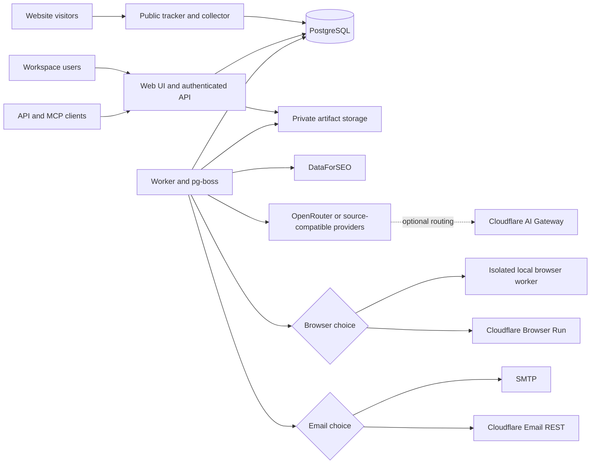

# Architecture and reuse decisions

Status: proposed implementation architecture, grounded in the [source traces](research.md). Nothing here is a measured production result.

## Decision: one portable TypeScript application

Use Elmo's portable TypeScript/React/TanStack Start, PostgreSQL, Drizzle and pg-boss patterns as the integration foundation. OpenSEO already shares much of that stack; adapt its domain services out of Cloudflare-specific workflows. Adapt Umami's tracker, recorder, report logic and SQL into the same application boundary. All three supply useful MIT code; no whole dependency manifest is approved by that fact.

This is a new combined repository, not a GitHub fork relationship with three parents. During implementation, import only audited source with commit/path attribution. Preserve useful history through a provenance ledger; do not check private deployment files or research clones into the new repo.

| Option considered | Result |
|---|---|
| Keep three apps and link their dashboards | Useful today, but does not meet one identity/project/data model requirement |
| Embed three apps behind one proxy | Leaves three upgrades, auth boundaries, runtimes and duplicate metrics; fails intended unification |
| Rewrite all features without reuse | Discards tested collection/measurement behavior and increases the full-parity burden |
| Fork Umami as the main shell | Strong analytics base, but both SEO/AEO applications use a different shared stack; more migration of workflow/services |
| Elmo-compatible portable foundation, selectively adapt the others | Recommended: retains durable PostgreSQL jobs and maximizes common SEO/AEO stack reuse |

The M1 integration spike must prove a tracker event, a queued provider stub, and one shared authenticated screen in this stack. If adapting Umami makes this demonstrably larger than an Umami-root approach, GPT revisits the choice before bulk porting. Do not maintain both Prisma and Drizzle or two routers in the final application.

## Stack contract

| Area | Choice | Reason / qualification |
|---|---|---|
| Language/runtime | TypeScript, Node.js 24 LTS line, pnpm | Shared upstream language; pin exact supported patches after compatibility/security checks |
| Web/UI/API | React 19, TanStack Start with production Node server | Elmo already has a native Node output; one router and auth boundary |
| UI primitives | Reuse audited Base UI primitives, native HTML and existing chart library | No parallel component systems; match the design tokens in ui-flows.md |
| Validation | Zod at HTTP, provider and job boundaries | Already used upstream; shared request schemas prevent drift |
| Auth | Better Auth core plus verified MIT-compatible generic OIDC integration | Reuse audited session/local-account logic; do not assume enterprise add-ons are MIT or free; use a standards OIDC client if necessary |
| Database | PostgreSQL 18, Drizzle, SQL migrations | One supported dialect; indexes and joins cover initial scope |
| Durable work | pg-boss, separate worker command | Already in Elmo; reuse retries/leases/schedules instead of writing a queue or adding Redis |
| Recorder | Audited rrweb path and Umami recorder behavior | Masking, sampling, chunk ordering, authorization and retention are release gates |
| Artifact storage | Local volume by default; S3-compatible option | Same authorization and metadata for replays, screenshots, exports and raw evidence |
| Rendering | Separate Chromium/Playwright worker OR Cloudflare Browser Run | Both are V1 options; full container/security details in provider-options.md |
| AI/SEO data | OpenRouter + DataForSEO primary, retain source adapter parity | Direct route or optional CF AI Gateway; adapter capabilities remain explicit |
| Email | SMTP OR Cloudflare Email Sending REST | Shared delivery/outbox semantics; owner configures sender and recipients |
| Validation tools | Existing Vitest and Playwright patterns; Docker integration checks | Reuse relevant upstream fixtures and license them correctly; no second framework |
| Distribution | One application image with web/worker/migrate commands, separate optional browser image | Prebuilt native runtime; no cloud-emulator requirement or production source build |

Versions are a proposal informed by the pinned sources, not an instruction to use mutable latest tags. Before importing, resolve one lockfile, check runtime compatibility, license inventory and advisories, and record the supported versions.

## Runtime topology

Gateway routing is selected before a provider request, not an extra second model call. The diagram shows logical options; the provider contract must not accidentally send both direct and gateway requests.

## Shared entities and module boundaries

| Entity group | Minimum fields / invariants |
|---|---|
| Users, sessions, identities | Local/OIDC identities; issuer+subject uniqueness; active/revoked state; 2FA and recovery; app users are never analytics visitors |
| Workspaces, teams, memberships | Role, optional project restriction; one user may belong to several; every mutation uses effective server-side membership |
| Projects, sites, brands | Workspace ID, canonical domain, allowed site origins, brand names/aliases/competitors, language/location/timezone |
| Credentials, connections | Workspace/provider/owner scope, encrypted value, key version, expiry, capabilities, last validation status; never send secrets to the browser |
| Analytics | Site/visitor/visit/events/properties/revenue/performance and report/cohort definitions; replay metadata and chunk references; retention boundaries |
| SEO | Saved keywords/tags, domains, backlinks snapshots, rank trackers/checks, crawl runs/pages/issues/edges, GSC/GA4 property connections |
| AI visibility | Prompts/tags/engine targets/schedules, runs/observations, model/surface/market, raw answer/citations/reported fan-out, mention-matcher version |
| Evidence and context | Project research/context sections, assistant sessions, immutable result provenance, versioned derived metrics |
| Tracking and domain groups | Browser destination configs/mappings/revisions; public pixel IDs separate from report credentials; canonical/serving/redirect domains, verification and source-labeled observations |
| Imported marketing reports | Provider/account/dataset snapshots, permissions, cursor, source timezone/currency/attribution and coverage; reuse existing GA4/GSC connections |
| Operations | Jobs, provider requests, usage reservations/settlements, alerts/outbox, reports/templates/shares, audit log |

Use explicit module folders inside one repository (`analytics`, `seo`, `visibility`, `identity`, `jobs`, `providers`, `reports`, `tracking`). These are code boundaries, not independently deployed services. Shared auth, spending and job services are justified by actual repeated consumers; do not create a generic plugin framework.

All project-owned records carry workspace/project ownership. Cross-table foreign keys and uniqueness enforce valid ownership where possible. Request handlers, background jobs, MCP tools and exports call the same authorization/domain functions. Identifier obscurity is never access control. Paginate list/export APIs; validate limits and parameterize SQL.

## Boundary contracts

| Boundary | Required behavior |
|---|---|
| Public `script.js`, collection/record endpoints | Website key is public; bounded schema/body/time validation, spam/rate controls, DNT/exclusion settings, no dashboard-session requirement |
| Internal management API | Authenticated session or scoped machine token, tenant authorization, CSRF checks where cookie sessions apply, safe errors |
| Jobs | Immutable project/workspace ID + caller intent + idempotency key; execution revalidates permissions/configuration and spend; credentials resolved at dispatch |
| Provider request | Typed capability and surface, requested model and actual model, market, quote/reservation, task ID, response status, usage and evidence |
| Browser request | Server-created job only, allowed target, byte/page/time limits, egress controls including redirects/subresources, result artifact references |
| Reports/MCP/assistant | Same services as UI; report output untrusted; tool writes/costs require explicit intent and authorization; revoke shares independently |

Keep compatible Umami ingestion as a deliberate migration endpoint or adapter; verify the tracker contract before changing it. Compatibility is not assumed for every upstream public API. Provide a published API/MCP surface with migration mapping and contract tests.

## One-snippet tracking and domain aliases

[Tracking & destinations](tracking.md) extends the existing tracker with a centrally configured loader for official vendor scripts. Collection flows browser-to-vendor; PostgreSQL/pg-boss are used for configuration and read-only report imports, not a new advertising conversion proxy. Native analytics ingestion remains independent. Shared consent and duplicate-ownership checks happen before SDK loading/invocation, and a vendor outage cannot block page navigation.

Report credentials never enter the public loader configuration. Connect account/property permissions independently from pixel enablement. Native events, SDK diagnostics and imported aggregates stay distinct; imported snapshots must never become outgoing tracking events. Reuse the same Google connections/services for P58 and the new dashboard.

Domains have canonical/serving/redirect roles. HTTP-only aliases use configured edge/server observations or P44 redirect instrumentation; landing-page JavaScript cannot reconstruct every redirect. Preserve original host and target, independently scoped GSC properties and backlink overlap. No alias grouping creates automatic cross-domain identity. See P70–P81 for acceptance gates.

## Money and execution correctness

1. Prepare a quote using current provider prices, prompt/keyword count, engines, repeats, rendering and schedule frequency. Store quote source/time and upper-bound assumptions. Missing price blocks automatic paid execution.
2. In one database transaction lock relevant account/workspace budget rows in a stable order, check spent plus outstanding reservations, reserve the upper bound, and enqueue a unique request.
3. Dispatch once with provider idempotency/task identity where supported. Scheduling leases and unique period keys prevent overlap after restart or DST changes.
4. Persist results and settlement with unique provider/request identifiers. Release only unused known reservation. Preserve failed-billable and uncertain charges.
5. Reconcile timeouts through provider task lookup before resubmission. If the provider cannot determine whether it charged, pause for review. Bounded retries apply only to safely retryable failures.

Budgets cover the app's dispatches, not activity from other clients sharing the provider account. Show balance age and available-vs-reserved estimates; insufficient provider credit pauses affected work. A hard application limit does not guarantee a provider never changes pricing or charges outside the quote. Configure provider-side caps where available.

## Metric contract

- Store UTC instants; display/project schedules use a named IANA timezone. Document DST skips/repeats and comparison periods.
- Preserve upstream definitions for visitors, sessions, bounce, funnel windows, attribution, retention, revenue currency and performance percentiles before combining charts. No cross-currency sum without an explicit rate policy.
- AI visibility denominator includes successful eligible observations only; show success/sample coverage and skipped/failed results separately. No successful samples means unavailable, never 0%.
- Consumer UI answers, direct model APIs and dataset research remain separately labeled. A direct model answer is not evidence of what a consumer search UI showed.
- Persist raw answers/citations and actual provider/model/version/location. Query fan-out is shown only when the provider returns it.
- Version mention matching and metric formulas. Reuse source fixtures; maintain baseline-compatible results and explicitly compare any improved alias/domain disambiguation.
- Cross-module insights link evidence: search impressions/rank, observed visit, conversion. They must not claim causal attribution or identify an AI citation as a visit without supporting event evidence.

## Authentication, privacy and assistant security

Roles: owner administers workspace/users/credentials; admin manages projects/operations; editor changes campaigns/prompts/audits under budget; analyst reads data and creates permitted reports; viewer reads assigned projects. Instance administrator powers are explicit and audited. Machine tokens have narrower scopes and expiry; public shares expose only selected report data and can expire/revoke.

OIDC uses issuer/subject, state, nonce, PKCE and verified callbacks, not email-only account linking. Role/group mapping cannot silently elevate users; deprovisioning invalidates sessions and tokens. Keep local recovery independent of external identity availability. Use a maintained auth library rather than invent password/session cryptography.

Replay is opt-in per site; block sensitive elements, mask inputs/text by default, sample and cap capture, and test redaction on realistic pages. Do not call all replay data anonymous. Retention, export and erasure apply to raw events, replays, evidence, reports, caches and recoverable backups under an operator policy.

Crawled pages, model answers and MCP results are untrusted content. Assistant instructions and tools cannot be overridden by a page. Separate read tools from writes and paid actions, preview requested changes/cost, require approved scope, and audit execution. Sanitize Markdown; render generated HTML reports in a sandboxed origin/frame with restrictive CSP. No secrets, arbitrary SQL, arbitrary shell or unrestricted network-fetch tools in the product assistant.

## Scaling and operational limits

Start with one PostgreSQL database, one worker and bounded concurrency. `ponytail:` PostgreSQL analytics and a single-host artifact volume are the initial ceiling; benchmark before adding ClickHouse or multi-host storage. No claim of unlimited analytics throughput.

Use indexes keyed by site/workspace/time, bounded batch inserts and retention jobs. Select partitioning/rollups only after the M2 workload shows the need. Protect ingestion from crawling with separate job concurrency, database pool and browser resource limits. Web requests do not run long audits or render browsers.

The only second execution environment required by chosen functionality is the optional sandboxed browser worker. Redis, Kafka, Kubernetes and a separate microservice for every module are not prerequisites.

## Migration and upstream maintenance

V1 migration tools operate on exported copies, never mutate original deployments. Map upstream IDs to new IDs with idempotent import records; produce counts, rejected rows and checksum/reconciliation reports. Import analytics events and report definitions, brands/prompts/competitors/runs/citations, and supported SEO projects/keywords/rank/audit artifacts after schema mapping. Users reauthorize OAuth/providers instead of importing incompatible encrypted secrets. Preserve source timestamps/provenance. Large replay datasets require a separate capacity/duration estimate.

Shadow-read and compare totals/metrics on the same interval, then switch one tracking integration/project at a time. Avoid double counting during dual recording. Keep original applications and backups until owner acceptance; rollback changes routing/tracker configuration, not source databases.

Maintain a reviewed patch ledger per imported upstream path/commit and track security fixes. Do not merge upstream main wholesale. Re-run affected parity fixtures before accepting updates. New upstream features enter through an explicit baseline change.

## Release risks and gates

Largest unknowns: porting Umami analysis semantics, preserving source provider behavior, source-hosted feature dependencies, auth/add-on licensing, full browser isolation on deployment importers, and data migration/retention at realistic volume. Resolve these with spikes and fixtures in the roadmap, not additional abstractions.

Reference platform primitives: [pg-boss](https://github.com/timgit/pg-boss), [PostgreSQL advisory locks](https://www.postgresql.org/docs/current/explicit-locking.html#ADVISORY-LOCKS), [Docker startup semantics](https://docs.docker.com/compose/how-tos/startup-order/). Repository/source evidence is pinned in research.md; platform versions must be rechecked during implementation.
