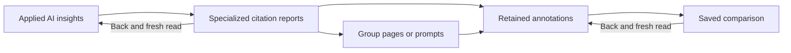

# Specialized citation reports — interface contract

Status: implemented locally with ten presentation and ten controller browser groups passing on 2026-10-14; see the [acceptance record](citation-specializations.md#local-implementation-and-acceptance--2026-10-14). All19 production navigation groups also pass; operational release acceptance remains separate. This read-only P19 increment uses retained annotations, not a new provider request or a fetched source page. It does not complete the full release plan or capture Google consumer shopping modules.

## Journey and protected controller

From AI insights, **Specialized citation reports** opens the already-applied date/model/prompt/tag scope. The first report is Reddit communities. Switch to Shopping links, Search queries or Citation gaps; inspect a group's pages, prompts or annotations; open a saved comparison; Back rereads the same selection. Back to insights rereads the parent. All current members can read and export; this screen has no context mutation or paid action.



The controller keys state to user/workspace/project and the inherited scope. Every read is validated against its exact filters, navigation and page index. One abort/generation guard fences reads and exports; Back and Cancel stop either. Current 401/403/404 clears protected data; 409 clears rows/cursors/revision and asks for Reload. Stale responses cannot restore roles/data or create a download. Whole-selection evidence manifests preserve learned answer expiry across pages, nested comparisons and the parent; unrelated prior-period expired IDs do not invalidate a selection that excludes them. Input expiry alone does not imply answer expiry.

Source filters are staged until Apply. Draft changes disable result navigation and export; Back or Reload asks before discarding them. Applying resets navigation and paging. A source filter changes annotation populations, summaries, groups and full CSV; the eligible-answer denominator and coverage still describe all base answers. Product attribution applies only to labelled shopping products. Group/page/prompt navigation does not change the population. Both periods remain explicit. Export means the full applied report, including all base citation-gap proof outside optional source filters, not the visible page. CSV downloads require verified headers, bounded UTF-8 bytes and record counts, and use a short-lived object URL.

Read/API contract: [citation specializations](citation-specializations.md). Server/client DTO validation remains outside the pure view. No raw response, API implementation, credentials or environment is an input to the presentation task.

## Self-contained presentation leaf

Implement only `src/components/CitationSpecializationsView.tsx`, exporting the named function and all types below unchanged. React type imports are allowed. No hooks, state, effects, requests, timers, storage, URL construction, parsing, arithmetic, sorting, mutations, router imports or server imports. No new dependency or CSS file. Everything is controlled; display supplied text literally as React text. Never render markup or images from evidence. Only supplied non-null `safeHref` may be an external anchor, with `target="_blank" rel="noopener noreferrer"`; do not derive a URL from an ID/title/label. Null title and empty title are distinct.

```ts
export type SpecializedView = 'reddit'|'shopping'|'search'|'gaps';
export type SpecializedPeriodId = 'current'|'previous';
export type SpecializedOption = {id:string;label:string};
export type SpecializedDraft = {
 grouping:'retained-fragment-v1'|'elmo-url-v1';query:string;
 ownership:string;entityId:string;publisherCategory:string;pageType:string;sourceType:string;
 productAttribution:'all'|'brand'|'competitor'|'other';
};
export type SpecializedCounts = {answers:string;annotations:string;prompts:string;pages?:string};
export type SpecializedGroupActions = {canPages:boolean;canPrompts:boolean;canEvidence:boolean};
export type SpecializedGroupRow = {
 id:string;label:string;details:string[];
 current:SpecializedCounts;previous:SpecializedCounts;
 currentActions:SpecializedGroupActions;previousActions:SpecializedGroupActions;
};
export type SpecializedPromptRowView = {
 id:string;preview:string;details:string[];counts:SpecializedCounts;
 statusLabel:string|null;coverageLabel:string|null;canEvidence:boolean;
};
export type SpecializedEvidenceRowView = {
 id:string;requestedAt:string;model:string;promptLabel:string;
 retainedUrl:string;safeHref:string|null;retainedTitle:string|null;
 retainedOrder:string;groupedUrl:string;classification:string[];canOpenComparison:boolean;
};
export type SpecializedScreen =
 | {kind:'groups';rows:SpecializedGroupRow[]}
 | {kind:'pages';rows:{id:string;groupedUrl:string;retainedUrl:string;safeHref:string|null;
     retainedTitle:string|null;counts:SpecializedCounts;changeLabel:string}[];canCommunityEvidence:boolean}
 | {kind:'prompts'|'gaps';rows:SpecializedPromptRowView[]}
 | {kind:'evidence';basisLabel:string;rows:SpecializedEvidenceRowView[]};
export type CitationSpecializationsViewProps = {
 prefix:string;role:'owner'|'admin'|'editor'|'viewer'|null;
 reading:boolean;exporting:boolean;error:string|null;notice:string|null;
 backLabel:string;canReload:boolean;canExport:boolean;
 report:null|{
  view:SpecializedView;title:string;selectionLabel:string;scopeLabel:string;snapshotLabel:string;
  groupingLabel:string;appliedFiltersLabel:string;measurementLabel:string;warnings:string[];
  denominatorLabel:string;overlapLabel:string;googleModuleLabel:string;exportLabel:string;
  periods:{id:SpecializedPeriodId;label:string;range:string;stateLabel:string;
    eligibleAnswers:string;coverageLabel:string;values:{label:string;value:string}[]}[];
  draft:SpecializedDraft;dirty:boolean;filterError:string|null;canApply:boolean;
  entities:SpecializedOption[];ownershipOptions:SpecializedOption[];publisherOptions:SpecializedOption[];
  pageTypeOptions:SpecializedOption[];sourceTypeOptions:SpecializedOption[];
  canNavigate:boolean;period:SpecializedPeriodId|null;canChangePeriod:boolean;
  unresolved:{id:'reddit'|'shopping'|'search'|'wrapper';label:string;
    currentLabel:string;previousLabel:string;canCurrent:boolean;canPrevious:boolean}[];
  emptyMessage:string;pager:{label:string;canPrevious:boolean;canNext:boolean};screen:SpecializedScreen;
 };
 onBack:()=>void;onReload:()=>void;onExport:()=>void;onCancel:()=>void;
 onDraftChange:(draft:SpecializedDraft)=>void;onApply:()=>void;
 onViewChange:(view:SpecializedView)=>void;onPeriodChange:(period:SpecializedPeriodId)=>void;
 onOpenGroup:(id:string,period:SpecializedPeriodId,target:'pages'|'prompts'|'evidence')=>void;
 onOpenPrompt:(id:string)=>void;onCommunityEvidence:()=>void;
 onUnresolved:(id:'reddit'|'shopping'|'search'|'wrapper',period:SpecializedPeriodId)=>void;
 onPrevious:()=>void;onNext:()=>void;onOpenComparison:(evidenceId:string)=>void;
};
```

### Layout and copy

Use existing `research-panel`, `stack`, `row`, `field`, `btn`, `ghost`, `hint` and `table-wrap` classes. Reuse inherited colors/type/borders; no new palette or framework. Section/fieldset/grid children use `minWidth:0`; long retained text wraps anywhere. Native controls and buttons have at least 44px height. Responsive filter grid uses `repeat(auto-fit,minmax(min(100%,180px),1fr))`; field wrappers have zero margin. At 360px only tables scroll horizontally, never the page. Native focusable labelled table scroll regions must be unique; do not give the outer section the same landmark name.

1. Header: h2 **Specialized citation reports**, scope, Back, Reload report, Export full report. Reading shows **Loading retained citations…**; exporting shows **Preparing CSV…**. While either is pending expose **Cancel loading** / **Cancel export**. Back remains usable. Error is `role="alert"`; notice/loading is `role="status"`. No duplicate live text.
2. Show report only when `role !== null && report !== null`. Otherwise hide all summaries, filters, rows and retained labels, even if an inconsistent prop supplies them. Back, allowed Reload and pending Cancel remain. An error never leaves a permanent loading message when `reading` is false.
3. Four compact buttons: **Reddit communities**, **Shopping links**, **Search queries**, **Citation gaps**; active `aria-pressed`. Follow with supplied `title` and nonempty `selectionLabel`. For a non-null `period`, show labelled Current/Previous period select; no change otherwise. Group results compare both periods side by side. Put results above secondary detail disclosures; avoid a large setup form before results.
4. Native closed `<details>` **Source filters** contains grouping select (Retained URL without fragment / Elmo URL grouping), search input maxLength 200, entity, ownership, publisher, page type, source type and product-attribution selects. Use supplied options verbatim, with All entries supplied by parent. Product choices All products / Brand / Competitor / Other. Explain **Product attribution filters labelled shopping products only.** All controls have unique IDs and associated labels. Edits call `onDraftChange({...draft, field:next})`; they do not apply. **Apply source filters** is `type="button"`; dirty text **Filters changed. Apply to update results.** Show supplied filterError. Dates/base scope are changed by returning to Insights.
5. Two compact period summaries: period label/range, state, Eligible retained answers and the supplied labelled values. Keep full coverage strings in a closed **Answer coverage** disclosure. Supplied denominator, overlap labels and every warning remain visible near summaries/results: partial, expired, incomparable or missing-identity limits must not be hidden. A separate closed **Selection details** contains snapshot, grouping, applied filters and measurement. Keep the Google module label visible for Shopping/Search, and exportLabel beside Export or in Selection details. Google module data is **Not recorded**, never zero or inferred from link labels.
6. `groups` table: label/details, Current counts, Previous counts, Actions. Counts are labelled Answers / Annotations / Prompts / Grouped pages (when supplied). Detail lines may collapse per row. Each period has independently gated **Current pages**, **Current prompts**, **Current annotations** (Previous equivalents); use `onOpenGroup(row.id,period,target)`. Pages appear only when that period's canPages is true. Do not offer pages for shopping/search. No anchor from a product/query label. Never add rows or show rankings/prices based on supplied titles.
7. `pages` table: Grouped URL, retained representative URL/title, counts, changeLabel. Anchor uses supplied safeHref only. **View community annotations** calls onCommunityEvidence; it opens the whole community, not an invented page filter. `newly observed` is an observation comparison, not proof that a web page was created.
8. `prompts` / `gaps` table: prompt preview, details (immutable version(s)), status/coverage when supplied, counts, **View annotations** / **Inspect gap evidence**. Both call onOpenPrompt(row.id). Gap evidence includes every eligible annotation for that prompt/period before optional source filters; do not call it matching-only. Show supplied uncertainty/status; do not claim absent brand evidence when brand identity is unavailable.
9. `evidence` table: retained title/URL, requested time/model/prompt, retained annotation order, classification and **Open saved comparison**. Show basisLabel before table. Null title: **No retained title**; empty title: **Empty retained title**. Grouped URL is labelled separately. Annotation order is saved order, not search rank, confidence or a source-text offset. All text is inert. No image, iframe, wrapper resolution or automatic cited-page fetch.
10. Unresolved rows render in closed **Other retained annotations**, with supplied current/previous count labels and individually gated **Inspect current** / **Inspect previous**. This preserves ungrouped Reddit links, shopping links without labels, search links without labels and Google wrappers. All four stay inspectable without pretending missing labels mean missing annotations. Use each id+period in accessible button names.
11. Empty table: show supplied emptyMessage instead of fabricating zeros or rows. Table headers remain accessible. Independent Previous page / Next page controls use pager capabilities and label. Use table min-widths around 720px for groups/prompts/pages and 960px for evidence, with practical per-column minima and date nowrap; long labels still wrap inside their cell.

### Capability and callback contract

The pure view must gate the handler as well as the native disabled state: synthetic clicks/changes on disabled controls must not call the parent. `known = role !== null && report !== null`; `idle = !reading && !exporting`.

- Back always calls onBack; pending Cancel calls onCancel only when reading or exporting. Reload requires canReload and not exporting (it may replace a held read). Export requires known, idle, canExport and !report.dirty.
- Draft controls require known and idle. Apply additionally requires report.canApply; allow valid Apply even when no draft difference. Tabs, period, row actions, unresolved actions and pager require known, idle, report.canNavigate and !report.dirty, plus their exact row/period capability. Period additionally needs canChangePeriod. Pages button must not be created for a false canPages; other disabled actions may stay visible.
- Open comparison requires evidence screen and the matching row's canOpenComparison. Every row handler uses only that supplied row ID, never text as identity. Empty data has no row actions. Disclosures themselves remain readable while exporting.
- No callback on mount/render, no auto-fetch/reload/export and no local mutation state. Do not calculate rates, totals, trends, counts or permissions; all display values and capabilities come from the controller. Do not invent owner-only rules for member reads/exports.

## Acceptance planned (not yet run)

Contained pure-view checks cover all four families/subviews, member export, unknown-role purge, inactive callback no-ops, dirty filters, null/empty titles, raw hostile text, missing-module copy, all-base gap evidence, keyboard and 1440/360 geometry. Protected-controller checks cover current denial vs held reads, A→B→A scope, changed cursor revision, read/export timeout/cancel, actual-byte CSV bounds and no stale download, filter-consistent requests, nested receipt Back revalidation and off-page manifest expiry. No live provider compatibility, crawling or full P19 parity is claimed by these checks.
