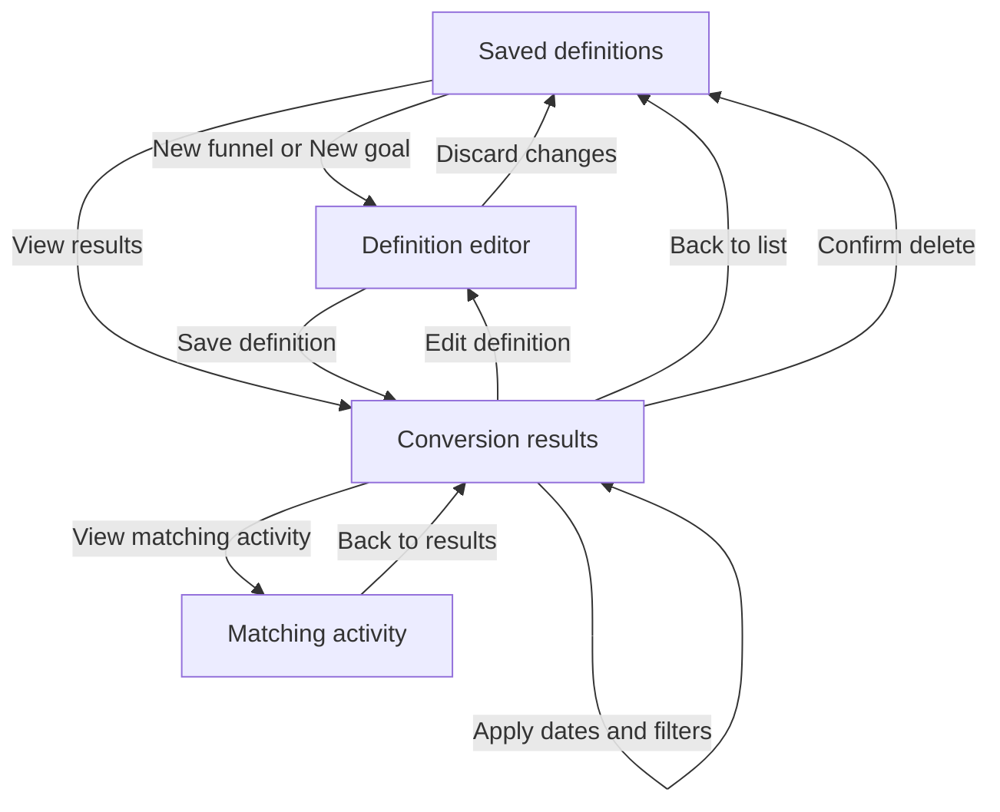

# Saved funnels and goals

Implementation issue: [#37](https://github.com/Ten98-IO-Company/ten98-monitor/issues/37). Saved funnels and goals now have project-scoped persistence, evaluation, matching-activity inspection and a browser interface. The local acceptance below covers this increment; it does not certify full V1 parity or production capacity. All 81 V1 requirements remain in scope.

## Measurement contract

The pinned [Umami collector](https://github.com/umami-software/umami/blob/ec0ff50388c264ed8ce46f00967e92f7e71476ae/src/app/api/send/route.ts#L156) distinguishes its month-rotating `session_id` from `visit_id`. Its [funnels](https://github.com/umami-software/umami/blob/ec0ff50388c264ed8ce46f00967e92f7e71476ae/src/queries/sql/funnels/getFunnel.ts#L134) count the former, corresponding to ten98's `visitor_id`. The interface says **estimated visitors**, and a funnel can span visits. Monthly keys are never stitched, and unidentified API/legacy observations cannot establish a visitor conversion.

Funnels contain 2–8 ordered steps. **Activity at path** accepts any matching activity; **Page views only** explicitly narrows a path step. Custom-event steps accept event-name and typed property conditions. Match operations are literal exact, prefix, suffix and contains; `%`, `_` and `*` are not SQL wildcards. The 1–1440 minute window applies between adjacent steps. Every reachable endpoint remains eligible, so a failed early attempt does not hide a later valid chain.

Receipt times must strictly increase. Unlike upstream's inclusive PostgreSQL timestamps, one event cannot complete repeated steps and equal-time observations do not prove an order. Shared filters apply to every step, resolving an upstream PostgreSQL/ClickHouse inconsistency explicitly. Negative property conditions require a present value of the selected type; missing is a separate predicate. These semantics use a named ten98 method version rather than promising identical upstream SQL results.

[Goals](https://github.com/umami-software/umami/blob/ec0ff50388c264ed8ce46f00967e92f7e71476ae/src/queries/sql/goals/getGoal.ts#L35) have one **Viewed page** or **Custom event** condition. The denominator is all identified visitors with any event in the shared scope; the target condition narrows only the numerator. Repeated matches count once per estimated visitor. A known population with no matching visitor is zero; no known population is unavailable.

Dates/timezone and common filters apply at evaluation, not to the saved definition. All steps must fall inside that calendar range, with Explorer's IANA/DST handling and retention watermark. Partial retention permits lower-bound observed participant counts, but drop-off counts and rates are unavailable: subtracting two lower bounds does not establish a valid drop-off. Saved definitions survive expired events. Drilldown returns actual matching event chains, never synthetic sessions or exposed visitor keys.

## Flow and visual design

Users are workspace members inspecting project conversions on desktop or mobile. Success means saving a definition, evaluating it for an explicit period, and opening matching activity that explains its count. Editors/admins/owners manage; viewers inspect. This uses the existing neutral/violet shell, system font, monospace paths, native controls and compact tables. Numbered steps encode real sequence; result bars encode measured fractions only.

The new **Measure → Conversions** page has **Funnels** and **Goals** tabs. Existing authored HTML reports remain under Reports. List → New/Edit → Save → Results is the short path. No provider connection or background job is needed.



| Screen | Primary action | Recovery and state |
|---|---|---|
| Saved definitions | Create first definition, or View results for an existing row | Loading/empty/error are distinct; Retry reloads the current project only. Tabs retain no cross-project drafts. |
| Definition editor | Save funnel / Save goal | Name and criteria are required; description is optional. Native add/remove/up/down buttons work by keyboard. Invalid JSON stays editable. Conflict reload is deliberate, and dirty exit requires confirmation. Lost responses offer the identical save request. |
| Conversion results | Apply dates and filters | Definition summary collapses; dates/timezone are compact and advanced filters start closed. Zero, unidentified observations and retention gaps have distinct copy. An error clears stale results and offers Retry. |
| Matching activity | Inspect the returned chain | Step paths, names, origins and receipt times are plain text. Back preserves applied scope and restores focus. Pagination is scoped and bounded; fresh reads can observe newly collected events. |

```text
Conversions                                  [Funnels] [Goals]
Saved funnels                                  [New funnel]
Name                    Updated                [View results]

< Back to list
Checkout sequence                              [Edit] [Delete]
> Definition: 3 steps, 60 minutes between steps
[From] [To] [Time zone]                         [Apply filters]
> More filters

Step / condition     Estimated visitors   From previous   Overall
1. Activity /pricing       observed count        —        rate
2. Event sign_up           observed count       rate      rate
3. Viewed /thanks          observed count       rate      rate
Each measured row                         [View matching activity]

< Back to results
Matching activity for step 3
Observed visitor 1
1 /pricing  · page_view · receipt time
2 /account  · sign_up   · receipt time
3 /thanks   · page_view · receipt time
                                             [Load more]
```

Wireframe names and paths are examples, never initial measurements. At 360px, editor fields stack and result tables scroll inside a labelled keyboard-focusable region. The sequence remains legible without color. No animation, remote font or chart dependency is required.

## Acceptance

On 2026-10-13 the supervising GPT independently executed the final query against an isolated PostgreSQL 18.6 database. All nine groups in `tests/funnels-integration.ts` passed: known 10/5/4 visitor chains and actual witnesses, later valid attempts, cross-visit identity, monthly splits, repeated/equal/sub-millisecond observations, eight overlapping steps with duplicate timestamps, exact adjacent windows, literal matches, typed/missing properties, goal numerator/denominator, DST/skipped dates, retention gaps, null identity, current roles and revision races, actor-bound retries, bounded pagination and exact-precision retention cursor invalidation. A real table lock produced the intended five-second timeout response and the next query recovered. No external request occurred.

Explorer's three existing database/API groups passed after extracting its shared scope SQL unchanged. The original-install migration suite passed checksum/history rejection, transaction rollback, preservation of owner/session/project/event, Google/financial/domain and actual audit evidence through `0020`, and idempotent migration. No definitions or jobs are invented by the migration. TypeScript, production build, 266 unit checks (two existing platform skips), the separate browser-environment guard and the 81-row plan check passed.

The final production build passed real Edge acceptance on a fresh synthetic database through `tests/conversions-ui/browser.mjs` and `editor.mjs`. These checks used real saved definitions, API routes and event rows: 3/2/1 counts and matching chains; typed-property edits; 1/3 page-view and custom-event goals; accepted mutations with lost/malformed acknowledgements and identical retries; failed edit loading; actual concurrent revisions and viewer demotion; stale success/401 across workspace selection; and deletion preserving collected events. The editor checks covered dirty-draft cancellation, keyboard step controls at two/eight limits, property transitions, labels and zero unintended writes. Desktop and 360px screenshots were visually reviewed; tables scroll by keyboard without page-wide overflow. These are focused accessibility checks, not a conformance certification. The browser and server fixture blocked outbound requests.

The first correlated query timed out on 100,000 events. A pair-expanding alternative was rejected after a PostgreSQL process was killed during stress testing; recovery and preview health were verified. Further stress work used a dedicated 1 GiB container. The final implementation carries the most recent reachable predecessor through ordered SQL windows, preserving all reachable endpoints without pair expansion or relying on estimated join cardinality. Count-only requests omit witness work; witness event IDs use indexed project-bound lookups in the same repeatable-read snapshot.

In that dedicated container (`shared_buffers=128MB`, `work_mem=4MB`), 100,000 events across 12,500 visitors took 466–486 ms for three steps and 909–956 ms for eight. A dense 10,000-event, all-matching eight-step funnel with a 1,440-minute window took 453 ms. Two eight-step witness pages took 930–1,017 ms and reconciled 100 distinct observed visitors and their real chains. These bounded local measurements are not production sizing or a general latency guarantee; larger ranges still fail explicitly at the statement timeout, with no sampling or fabricated zero.

### Optional local performance regression

Use a **separate PostgreSQL instance and fresh, migrated database** named `ten98_funnels_performance_<suffix>`, with loopback `APP_URL` and `DATABASE_URL` and no connection-string query overrides. Put that test configuration and both `TEN98_PERFORMANCE_TEST=1` and `TEN98_INTEGRATION_TEST=1` in an ignored environment file, then run `node --env-file=.env.funnels-performance tests/funnels-performance.ts`. The runner refuses existing users/projects, exercises 100,000 distributed events and 10,000 dense events through eight-step funnels, and verifies two pages of actual witnesses without exposing visitor hashes. It keeps the application's five-second query deadline and a two-minute runner deadline, prints bounded timings, and leaves synthetic data for inspection. It never clears a database, starts a worker or calls an external provider. This substantial opt-in load is excluded from automatic CI; timings depend on the host and are not a deployment throughput guarantee.

The supervising GPT ran this public runner independently on another fresh database in the dedicated container. It passed: the initial 100,000-event count query took 3,165 ms, witness pages 925/1,011 ms, and the dense query 437 ms. This variation from the earlier measurements is retained rather than presenting the faster timings as guaranteed latency.
