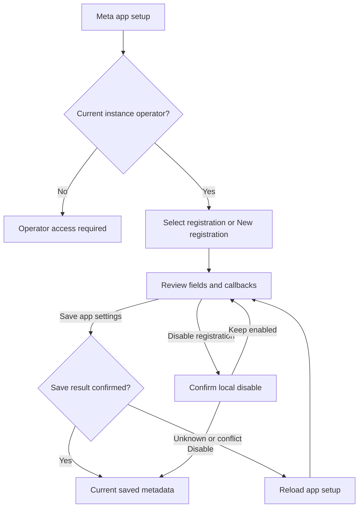

# Meta app setup interface

**GPT-reviewed presentation contract, 2026-10-13.** This operator screen configures app registrations. It does not prove Meta approval, connect an ad account or import a report. Kimi receives only the reviewed self-contained leaf after publication; GPT owns the protected controller and API mapping.

## Goal and evidence

An instance operator can select an existing registration or create one, review its exact callback addresses, save deliberate settings and disable access independently of secret availability. The successful state is **App settings saved**, with current metadata reloaded. Project owners subsequently use the separate [Meta connection flow](meta-connection-ui.md).

The wire evidence is `getMetaApp`, `saveMetaApp` and `disableMetaApp` in `src/server/meta-auth.ts`; [Meta reports](meta-reports.md) records provider prerequisites. Existing `GoogleAppPanel.tsx` informs the operator/project separation, write-only secret and selectable callback pattern. This is original interface design; no upstream code is copied. UX Flow Wireframer and UX Copy Refiner guide the sequence and terminology.

Entry is **Settings → Meta app setup**, including an explicit return from a project connection screen. Operator status alone grants no workspace, project or report access. A nonoperator sees a short explanation and navigation/reload, never cached registration IDs, secrets, callback configuration or editing controls.

## Actual wire semantics

| Operation | Current behavior and mapping |
| --- | --- |
| `getMetaApp(userId, params)` | Params are optional `registrationId` and `cursor`, once each. Returns `operator`, active-app `configured`/`enabled`, `vaultConfigured`, `httpsReady`, exact `redirectUri`, `activeRegistrationId`, selected `registration`, registration page and `nextCursor`. Operator list is 50/page; the selected registration may be outside that page. Preserve its summary independently. |
| Registration metadata | `{id, appId, configId, revision, active, enabled, declaredMode, boundOrigin, deleteDataUrl}`. No app secret. The selected registration's enabled/active values govern its form; the envelope's enabled flag describes the active app and must not overwrite an inactive registration. |
| `saveMetaApp(userId, body)` | Body is `{activeRegistrationId, revision, appId, configId, appSecret?, activate, enabled, declaredMode}`. Active-registration ID plus selected app-ID revision form the comparison check. New app ID uses revision0 and requires a secret; existing app keeps its secret when the field is omitted. No blank-string secret is submitted. |
| Activation | `activate:true` explicitly chooses this registration for future new connections and deactivates the previous active registration. `activate:false` preserves this registration's existing active/inactive state; it does not deactivate an already-active app. New registrations default inactive. Enabled and active are different settings. |
| Disable | `disableMetaApp(userId, registrationId, {revision})` changes enabled state through a separate keyless path. It works for active or inactive selected registrations and does not require a decryptable old secret. Its response defaults to active registration metadata; the controller must reread the captured target ID before claiming that selected registration is disabled. |

Existing registration app ID is read-only. **New registration** is the explicit route to another app ID. This avoids accidentally using an existing registration revision against a new identity. Config ID, mode, enabled state and optional replacement secret remain editable. Server validation is authoritative; the presentation preserves intermediate raw strings and never coerces an app/config ID to a number.

Saving changes the registration revision and requires affected sources to reconnect; retained reports remain subject to retention/deletion rules. Activating another registration changes which app starts new connections; it is not a claim that the other registration or all its retained data was deleted. Disable is not grant revocation at Meta and is not data deletion.

## Minimal flow



| Screen/state | Primary action | Recovery |
| --- | --- | --- |
| No registrations | New registration | Read HTTPS/vault prerequisites; do not suggest a hosted shared app. |
| Existing or new draft | Save app settings | Explicit reload after a conflict, or correct field errors; no autosave. |
| Saving | Saving app settings… | Clear the visible secret immediately; lock draft and navigation while the write is in flight. |
| Unconfirmed save/disable | Reload app setup | No same-request secret retry, no automatic resend and no newly inferred success. |
| Disable confirmation | Disable registration | Keep enabled returns to the same draft; confirmation states the impact. |
| Read failure | Reload app setup | Hide protected stale metadata when authority is not established; Back remains available during a read. |
| Saved metadata | Save app settings only after another edit | Notice says saved locally, not verified by Meta. |

```text
Meta app setup                             [Back to connections]
Configure this installation's Meta app. This does not grant project access.
[Reload app setup]

Registration [123… · Active · Enabled v]     [New registration]
[Previous registrations] [Next registrations]
Selected: App 123… · Active · Enabled

App ID [123… read-only for existing registration]
Facebook Login configuration ID [456…]
App secret [password field, blank]
Leave blank to keep the stored secret. New registrations require a secret.
[ ] Enable this registration
Operator-declared app mode [Development v]
[ ] Use this registration for new connections  (inactive/new only)
Activating changes the app used for new connections.
[Save app settings]

[Callback addresses: native disclosure]
 OAuth callback [exact read-only server value] [Copy address]
 Data-deletion callback [selected registration value] [Copy address]
 New registration: save before a registration-specific callback exists.
[Meta prerequisites: native disclosure]
[Registration details: native disclosure]

[Disable registration]  (separate from the save form)
```

The callback disclosure defaults open for a new registration and when no prior setup exists; it may collapse for existing registrations. Only the OAuth callback and selected registration's implemented deletion callback are shown. There is no invented deauthorization endpoint or privacy-policy address. URLs are exact selectable text; never reconstruct or transform them in the leaf. The controller handles copying with a scope guard; read-only text remains a fallback.

Prerequisites are concise: use a stable HTTPS origin; configure Facebook Login for Business with the reviewed user-token configuration and reporting permission `ads_read`; supply the app's own privacy policy and the shown deletion callback; external-business access may require Meta review. **Operator-declared mode is not Meta approval.** Do not offer a localhost shortcut or promise all advertising accounts will be discoverable. Link only the already reviewed official setup guide through the parent if one is supplied; no URL is required in this pure leaf.

## Controller obligations

The controller is keyed by authenticated user and clears secrets on submit, registration/new selection, explicit reload, access loss and unmount. No secret is populated from a GET, echoed in an error, copied, logged, serialized to browser storage or kept as a replayable intent. A saved secret is not a placeholder password. An empty existing secret field omits `appSecret`; a new registration requires nonempty input. A secret typed before failure is not silently restored.

A current401/403/404 or `operator:false` invalidates all earlier reads and clears protected state. Stale failures from a prior scope cannot sign out the current user. Validate the entire metadata envelope and selected identity. Pagination replaces the registration page, preserving the separately verified selected record; cursor stacks reset on a fresh reload. Selecting a registration/new draft and Back are interruptible reads, but cannot abandon a sent or unconfirmed write. Dirty-draft discard confirmation belongs to the controller.

Transport loss,408,429,5xx and malformed2xx after submission mean the outcome is unconfirmed. Disable further mutations and use **Reload app setup** to read current metadata. A409 also requires explicit reload/review; never silently rebase the save. Do not claim that metadata alone proves a particular secret value was stored. After reloading, ask the operator to review current settings and re-enter a secret only if they intend another change. There is no generic **Retry same request** for this screen.

The separate Disable action uses a captured registration/revision and an explicit confirmation. It remains available for an existing enabled registration when `canSave` is false because the vault or HTTPS setup is unavailable. It still requires current operator authority and idle mutation state. It performs no remote revocation. At the revision cap, disabling remains possible even though another save is rejected. Use the returned state only after revalidating the target record; no stale active-app response may stand in for disabling an inactive selected app.

## Self-contained presentation leaf (reviewed)

One file, `src/components/MetaAppView.tsx`. Pure controlled JSX, native controls/details and callbacks. No fetching, effects, timers, secret persistence, clipboard implementation, URL construction, navigation, API/server-runtime imports, dependencies, CSS files or nested forms. No arithmetic or invented readiness. Reuse `research-panel`, `stack`, `field`, `row`, `btn`, `hint`, `alert`; use inline44px targets and `minWidth:0` where required.

```ts
export type MetaAppChoice = { id: string; label: string };
export type MetaAppSelection = {
  id: string; appId: string; statusLabel: string; revisionLabel: string;
  active: boolean; enabled: boolean; boundOrigin: string;
};
export type MetaAppCallback = {
  kind: 'oauth' | 'deletion'; label: string; url: string; helper: string;
};
export type MetaAppViewProps = {
  prefix: string;
  operator: boolean | null;
  reading: boolean;
  writeState: 'idle' | 'submitting' | 'unknown';
  error: string; notice: string; readiness: string;
  choices: MetaAppChoice[];
  selected: MetaAppSelection | null;
  newRegistration: boolean;
  canPrevious: boolean; canNext: boolean;
  appId: string; configId: string; secret: string;
  enabled: boolean; declaredMode: 'development' | 'live'; activate: boolean;
  canSave: boolean; canDisable: boolean;
  confirmDisable: boolean;
  callbacks: MetaAppCallback[];
  backLabel: string;
  onSelect: (id: string) => void;
  onNew: () => void; onPrevious: () => void; onNext: () => void;
  onAppId: (value: string) => void;
  onConfigId: (value: string) => void;
  onSecret: (value: string) => void;
  onEnabled: (value: boolean) => void;
  onMode: (value: 'development' | 'live') => void;
  onActivate: (value: boolean) => void;
  onSave: () => void;
  onReviewDisable: () => void; onDisable: () => void; onKeepEnabled: () => void;
  onCopy: (kind: 'oauth' | 'deletion') => void;
  onReload: () => void; onBack: () => void;
};
```

Fixed copy:

- Intro: **Configure this installation's Meta app. This does not grant project access.**
- Nonoperator: **Only an instance operator can view or change Meta app setup.**
- Secret helper: **Leave blank to keep the stored secret. New registrations require a secret.**
- Secret handling: **The secret is sent once and cleared on submission. It is never shown or retried automatically.**
- Revision impact: **Saving changes requires affected sources to reconnect. Retained reports remain subject to retention and deletion rules.**
- Mode helper: **This is your declared app mode, not verification or approval by Meta.**
- Activation helper: **Activating changes the app used for new connections. It does not delete other registrations.**
- Ambiguous write: **The result is not confirmed. Reload app setup before making another change.**
- Disable consequence: **Disable this registration to stop new access through it. This does not revoke the grant at Meta or delete retained reports.**

Render rules:

1. Root `research-panel stack`, heading **Meta app setup** with `id=prefix+'heading'`, `tabIndex=-1`. Use existing neutral/violet styles, one primary Save action, wrapping rows and44px actions. Secondary callbacks/prerequisites/registration metadata use native details. No provider images or raw HTML.
2. `operator===null` shows supplied error or loading, **Reload app setup** and Back only. `operator===false` shows the fixed nonoperator explanation, supplied error/notice, Reload and Back only. Never render stale choices, draft, secret, selected metadata or callbacks for either state even if capability props are true.
3. Every button is `type=button`. While `submitting`, disable all controls, navigation and Reload. While `unknown`, only **Reload app setup** is available (disabled during a read); show the fixed ambiguous-write copy. Do not render a retry-secret action. During an ordinary read, disable competing actions but allow Back.
4. Registration list is a native labeled select with controlled selected ID. New mode uses a blank **New registration** option. If a selected record is off the current page, include its option once so the selection stays visible. Labels are prepared strings; IDs remain exact strings. **New registration**, Previous/Next and Reload are explicit callbacks; no selection causes a save. Show **No registrations on this page** when choices are empty without claiming none exist anywhere.
5. Render fields only for new mode or a non-null selected registration. App ID is controlled `type=text`, numeric input mode, max40, read-only for existing selection. Config ID is controlled text, numeric input mode, max40. Secret is controlled `type=password`, `autoComplete=new-password`, max512; no reveal/copy feature. Preserve raw input strings. Each label/helper has a stable ID/`aria-describedby`; no placeholder-only label.
6. Enabled checkbox and declared-mode select are explicit draft fields. Activation checkbox appears only for new or inactive selected registrations, unchecked until parent says true. Existing active registration shows **Active for new connections** instead of a misleading unchecked activation switch. The leaf does not infer provider readiness from these settings.
7. Save requires current operator, `canSave`, idle/not-reading, nonblank app/config IDs and a nonempty secret for a new registration. Existing blank secret is permitted. The controller validates exact syntax/identity; the leaf performs no normalization or number conversion. Form fields and Save lock during Disable confirmation.
8. For an existing selection, **Disable registration** is separate from Save and governed by `canDisable`, never by `canSave`, secret contents or readiness text. Review callback opens the controlled confirmation section with the fixed consequence and **Disable registration** / **Keep enabled** buttons. Confirm calls `onDisable` only; it does not save edited fields. Disable/readiness contradictions are resolved by current server-derived capabilities, not invented leaf logic.
9. Callbacks are readonly selectable inputs or textareas with exact supplied strings and **Copy address** buttons, individually labeled by callback kind. `onCopy` receives only kind. The fallback text remains usable without clipboard permission. Do not synthesize deletion URLs in new mode; show **Save this registration to get its data-deletion callback** when it is absent there. Only supplied implemented callback kinds appear.
10. Existing summary shows selected app ID/status; revision and bound origin are secondary details. Readiness is supplied text, not a **Verified** badge. Errors use alert and notices/progress use status. All provider/app text renders as text. The leaf neither starts a connection nor displays imports as available.

## Copy and acceptance

| Element | Avoid | Use | Reason |
| --- | --- | --- | --- |
| Mode | Meta verified | Operator-declared app mode | A local flag does not grant provider approval. |
| App switching | Replace app | Use this registration for new connections | Other registrations and deletion callbacks remain meaningful. |
| Secret error | Retry save | Reload app setup | A secret mutation is not automatically replayable. |
| Disable | Revoke Meta access | Disable registration | The operation is local and keyless. |
| Callback | Example address | Exact server-returned address | Origin and registration binding must be preserved. |

Glossary: **registration** is the retained local Meta app identity; **active** chooses the app for new connections; **enabled** allows access through that registration; **connection** is a project source; **grant** is provider permission. No additional product decision is assumed beyond these actual services. Open gate: root review/publication, protected controller mapping and real integration acceptance remain required before this flow is presented as working.

Independent tests must cover active/inactive paging and an off-page selected record; new registration with explicit activation; exact long digit IDs and hostile plain text; no secret returned/refilled; ambiguous Save clears and locks until fresh metadata; malformed2xx and current denial defeating held successes; keyless Disable with unavailable vault and revision cap; inactive-target Disable reread; unknown Disable metadata recovery; current nonoperator purge despite true capability flags; full callback text/copy fallback; keyboard labels,44px controls and360px wrapping. A pure leaf fixture proves presentation only. Real API/local synthetic acceptance must precede integration; no live Meta consent or imports are implied.
