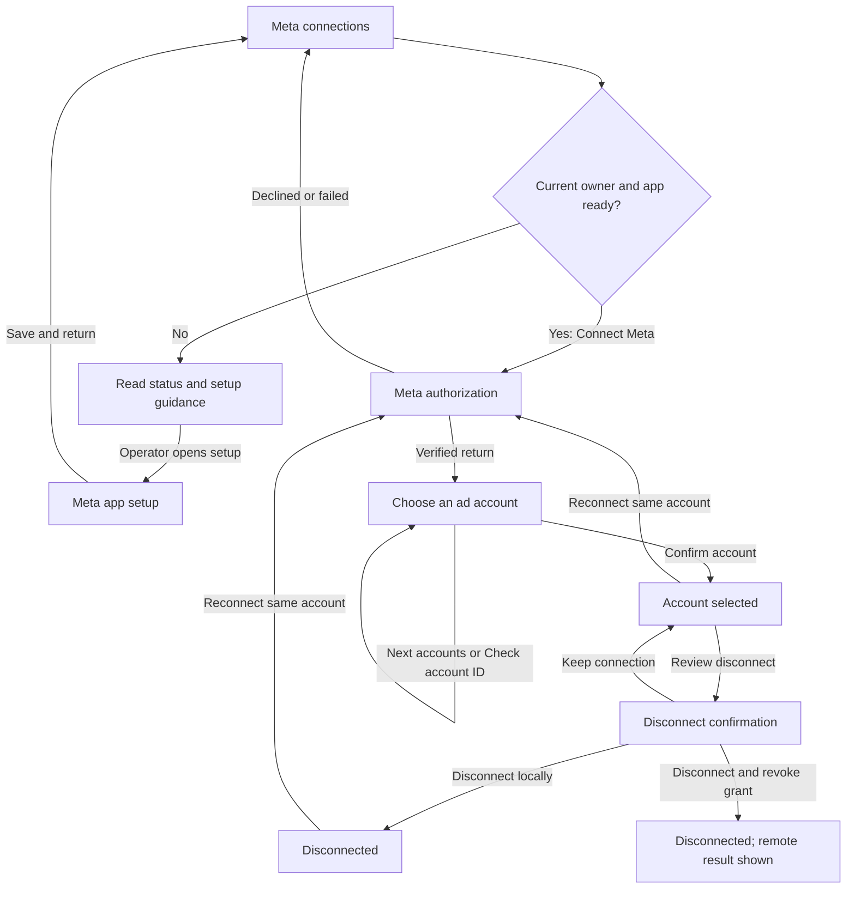

# Meta connection and account selection

**GPT-reviewed presentation contract, 2026-10-13; auth wire DTO mapping pending.** This specifies connection setup, not a working importer. Publish before Kimi receives the approved leaf. No private transcript, token or customer data is a draft input.

## Goal and existing patterns

A project owner connects a Meta grant and deliberately selects one verified advertising account. Success is **Account selected**, with its name, immutable ID, currency, time zone and access state; it is not import success, active tracking, or proof every asset is visible.

Use project **Connections → Meta ads** beside Google reports and separate instance **Settings → Meta app setup**. Reuse `research-panel`, `card`, `stack`, `field`, `row`, `btn`, `hint`, `alert`, `table-wrap`, native details and the neutral/violet design. One primary action per step, responsive fields and 44px actions; no wizard or new library.

Evidence: [Meta contract](meta-reports.md), [Google reports](google-reports.md), and existing `GoogleAppPanel.tsx` / `GoogleReportsPanel.tsx`. Reuse operator/project separation, source summaries and explicit selection; not Google's token/PKCE assumptions or ambiguous-save behavior. This is original design; no upstream code copied.

## Authority and capability boundaries

| Person or state | Visible flow and actions |
| --- | --- |
| Instance operator | Configure the installation's Meta app. Operator status alone does not authorize project connections or retained reports. |
| Current project workspace owner | Connect, discover/revalidate accounts, choose an account, reconnect, and disconnect. Remote grant revocation is an additional explicit choice only when the implemented capability is available. |
| Current admin, editor or viewer | Read project connection metadata and any separately implemented retained reports. No connection, discovery, selection, renewal, disconnect or import controls. |
| Membership unknown/lost | Remove account options, connection data and actions. Show loading or access recovery; never leave a cached owner form visible. |
| App disabled or vault unavailable | Explain the prerequisite; retain readable connection/report metadata and the owner's local disconnect action. No dead link to an operator screen the user cannot open. |
| Retained payload expired/deleted | Show that state in the report surface. Reconnecting does not restore expired/deleted data; a token-expiry date is not a report-retention date. |

The project panel never receives secrets or changes sign-in, campaigns, consent or pixels. No import/schedule button until the separate operations exist and pass acceptance. Full P76/P81 reporting and scheduling remain required.

## Flow



| Step | Intent | Primary action | Recovery |
| --- | --- | --- | --- |
| Meta connections | Understand current source/access or add one | Connect Meta | Ask the instance operator when setup is unavailable; Reload connections after a read failure |
| Meta authorization | Grant read-only advertising access in Meta | Meta's own consent action | A fixed, sanitized return notice; no raw provider error, code or token in the page |
| Choose an ad account | Pick the exact source from this grant | Confirm account | Page the accessible list, explicitly check an account ID, reconnect, or return without saving |
| Account selected | See saved source and current access | Reconnect when needed | Create a separate connection for another account; no account replacement disguised as reconnect |
| Disconnect confirmation | Choose local removal or wider revocation | Disconnect locally by default | Keep connection; remote revocation is separate and never preselected |

Account review and confirmation occupy one screen. Radio selection updates the summary without saving. Discovery is an explicit free read, not proof of permission across all assets.

## Operator setup screen

Keep this a separate future leaf: app ID, Facebook Login for Business user-token configuration ID, write-only app secret, enabled state and operator-declared mode. Show exact server-returned HTTPS OAuth callback and only implemented/verified registration-bound provider callbacks. Copy has a selectable read-only fallback. Instructions cover `ads_read`, privacy/deletion prerequisites, own-account access versus external-business review, and stable HTTPS; no unverified localhost exception or invented privacy URL.

**Saved by operator** is not **Verified by Meta**. App-ID change creates a registration; same-app rotation changes revision. Explain that existing sources need reconnect while retained reports remain. Secrets stay blank/password-masked and clear on submit/scope loss. Unknown save acknowledgement requires fresh metadata before re-entry; do not silently resend secrets. Disable remains available without a decryptable old secret. This project's retry rules do not define operator-secret mutation semantics.

## Project screens and copy

```text
Meta ads                              [Reload connections]
Read-only advertising account access. This does not install a pixel.
[Add a Meta connection: details open only when none exist]
  Connection name [Quarterly advertising                  ]
  [Connect Meta]
  You will approve access in Meta and return to choose an ad account.

Quarterly advertising                 Account selection needed
[Choose account]

Saved source name                     Account selected / Reconnect needed
Account name · Account 123456789 · USD · America/New_York
Token access: expires … / expiry not reported
Data access: expires … / expiry not reported
[Connection details]                  [Reconnect] [Review disconnect]
```

Missing setup: **“Meta connections are not enabled on this installation. Ask the instance operator to finish Meta app setup.”** Only an actual operator gets **Open Meta app setup**. Read-only members get the role copy in the leaf below.

```text
Choose an ad account                   [Back to connections]
Connection: Quarterly advertising
Showing accounts returned for this grant. This may not include every account.
( ) North campaign · Account 123456789 · USD · America/New_York
( ) Other account  · Account 987654321 · AED · Asia/Dubai
[Previous accounts] [Next accounts]    [Reload accounts]
[Use an account ID: closed details]
  Ad account ID [digits only] [Check account]
Selected account
  North campaign · Account 123456789 · USD · America/New_York
  This account stays attached to this connection. Add another connection to use a different account.
[Confirm account]
```

Never select the first account automatically. Equal names remain distinguishable by exact digit-string IDs, never JavaScript numbers. Render metadata as text. Confirm enables only for a server-validated candidate with all required source fields; unknown currency/time zone is not ready.

Page replacement preserves the separate selection only within the same connection/revision/grant. Clear it on reconnect, scope/revision change or access loss. The server revalidates on commit. Show reviewed account status without inferring that inactive advertising means unreadable, or active advertising means reporting permission.

Empty success: **“No accounts were returned for this grant.”** End of discovery: **“The returned list is complete for this request; it may not include every account you expect.”** Partial: **“Account discovery is incomplete. Load the next page or check a specific account ID.”** Failure is distinct with retry. Direct ID accepts at most40 digits; **Check account** validates without saving. Unknown/denied IDs use generic errors. Final pagination/direct-validation DTOs remain required.

Reconnect shows and preserves the original account ID. Failed access retains source identity/reports and asks for reconnect; it never offers silent account replacement. A different account needs a new source. Duplicate active account selection yields a same-project conflict and **Reload connections**, with no cross-workspace disclosure.

Require the approved positive token-expiry evidence for usable authorization. Data-access expiry may be unknown; label it **Expiry not reported**, never **Never expires**. Reinspect before every account operation. Expired/revoked/missing-permission access offers **Reconnect** while retained reports follow separate retention/deletion rules. Display server-derived readiness; a client timer grants no authority. Notices use status; errors use alert.

### Disconnect confirmation

```text
Disconnect “Quarterly advertising”?
Local credentials will be removed and new work stopped.
Retained reports remain subject to retention and verified deletion requests.
Account: North campaign · 123456789
[Disconnect locally] [Keep connection]
[Also revoke access at Meta: closed details, only if supported]
  Revoking this app grant can affect other sources, including ones you cannot view.
  [Disconnect and revoke grant]
```

Local disconnect requires no usable vault or Meta request. Remote revocation is separate, never automatic; local removal commits first. Show confirmed revocation only for evidence, otherwise **“Disconnected locally. Meta revocation was not confirmed. Review the app grant in Meta.”** No automatic remote retry or cross-workspace impact counts. Verified deletion is separate; local-deleted status does not mean backup/compliance cleanup is complete.

## Controller and acknowledgement requirements

GPT owns controller, callbacks, schema and router guards. Key by user/workspace/project; capture connection/revision for account reads. A current401/403/404 or scope change invalidates all older responses and clears protected state. Every envelope rechecks role. Reads are interruptible; sent/unknown mutations lock intent and navigation until resolved. Scope/session loss still purges state.

Selection/disconnect freeze actor-bound request UUID, revision, operation, connection and account/flags. Network loss,408,429,5xx or malformed2xx retain this intent for **Retry same request**, never a new ID/account. Validate the entire returned identity/outcome before clearing it. A known revision conflict ends the attempt and requires explicit reload/review; no silent rebase.

OAuth start has different approved semantics: only binding digests are retained, so replaying its request ID returns409/restart-required. A lost or malformed start acknowledgement shows **Start authorization again**, an explicit new request ID; never auto-retry the ambiguous start. A consumed/expired flow is not re-exchanged. Callback handling accepts only the fixed sanitized result/scope, clears it promptly and respects newer navigation. The controller validates the exact Meta authorization URL before navigation; never display/log it.

Editing, selecting, rendering and expanding details send no requests; no renewal/discovery loop or report/job creation. Clipboard copies only public callback/account IDs, fenced by scope. No codes, tokens, proofs or provider cursors in props, storage, logs or browser URLs.

## Self-contained presentation leaf (reviewed)

One pure controlled file: `src/components/MetaConnectionView.tsx`. No fetch/effects/timers/storage/router/navigation/clipboard/URL parsing/API or server-runtime imports/new dependency/CSS/nested form. Native details/radios and callbacks only. Dates/status/completeness are prepared strings; no invented totals, countdowns or access rules.

```ts
export type MetaConnectionCard = {
  id: string; name: string; statusLabel: string; statusDetail: string;
  accountLabel: string; currencyLabel: string; timeZoneLabel: string;
  tokenExpiryLabel: string; dataExpiryLabel: string;
  canChoose: boolean; canReconnect: boolean; canDisconnect: boolean;
};
export type MetaAccountOption = {
  id: string; name: string; currency: string; timeZone: string;
  statusLabel: string; selectable: boolean; unavailableReason: string | null;
};
export type MetaConnectionViewProps = {
  prefix: string;
  role: 'owner'|'admin'|'editor'|'viewer'|null;
  loaded: boolean; reading: boolean;
  writeState: 'idle'|'submitting'|'unknown';
  error: string; notice: string;
  mode: 'connections'|'account'|'disconnect';
  setupMessage: string; canOpenAppSetup: boolean; canConnect: boolean;
  name: string; connections: MetaConnectionCard[];
  connectionName: string; connectionAccountLabel: string | null;
  accounts: MetaAccountOption[]; discoveryLabel: string;
  discoveryState: 'not_loaded'|'loaded'|'empty'|'partial'|'failed';
  canPreviousAccounts: boolean; canNextAccounts: boolean;
  selectedAccount: MetaAccountOption | null;
  accountId: string; canCheckAccount: boolean; canConfirmAccount: boolean;
  canRemoteRevoke: boolean; canRetrySame: boolean; canRestartConnect: boolean;
  pendingActionLabel: string;
  onName: (value:string)=>void; onAccountId: (value:string)=>void;
  onConnect: ()=>void; onOpenAppSetup: ()=>void; onReload: ()=>void;
  onChoose: (connectionId:string)=>void;
  onReconnect: (connectionId:string)=>void;
  onReviewDisconnect: (connectionId:string)=>void;
  onPreviousAccounts: ()=>void; onNextAccounts: ()=>void;
  onReloadAccounts: ()=>void; onPickAccount: (accountId:string)=>void;
  onCheckAccount: ()=>void; onConfirmAccount: ()=>void;
  onDisconnect: (revokeAtMeta:boolean)=>void;
  onRetrySame: ()=>void; onRestartConnect: ()=>void; onBack: ()=>void;
};
```

Required fixed copy within this leaf:

- Intro: **Read-only advertising account access. This does not install a pixel.**
- Add-connection helper: **You will approve access in Meta and return to choose an ad account.**
- Selection helper: **This account stays attached to this connection. Add another connection to use a different account.** Selecting saves a source; it does not import a report.
- Local disconnect: **Local credentials will be removed and new work stopped. Retained reports remain subject to retention and verified deletion requests.**
- Wider revocation: **Revoking this app grant can affect other sources, including ones you cannot view.**
- Read-only role: **A workspace owner can connect or change sources. Your access to retained reports follows your current workspace role.**

Render rules:

- Outer `research-panel stack`; heading **Meta ads** with `id=prefix+'heading'` and `tabIndex=-1` for controller-managed focus. Use stable callback IDs; no array-index identity for accounts/connections.
- When `role===null`, show loading or the supplied error and **Reload connections** only. No previous account/connection data or setup privilege is rendered.
- When `role!=='owner'`, omit every mutating/discovery control even if an incorrect capability prop says true. Readable connection cards and current status remain; do not treat operator status as owner.
- While `writeState!=='idle'`, disable forms, navigation, selection, reconnect/disconnect and reload. For `unknown`, the owner gets **Retry same request** when `canRetrySame` (selection/disconnect only), or **Start authorization again** when `canRestartConnect` (OAuth start only); these capabilities are mutually exclusive. A read may be interrupted by **Back to connections**; disable competing provider reads/commits while `reading`.
- Connections: Add disclosure defaults open only when no connections; controlled name max120 with visible label. **Connect Meta** requires owner, `canConnect`, nonblank name, idle and not reading. Cards show prepared metadata as plain text and secondary details collapsed.
- Account: native radio fieldset with legend **Ad account**, exact string value/ID, visible name+ID+currency+time zone, and reason for disabled options. No preselected default. Render selected summary independently of the current page. **Confirm account** requires owner, `canConfirmAccount`, non-null selectable selection, idle and not reading. Direct ID input uses `inputMode=numeric`, maxLength40 and a visible helper; preserve raw edits for controller validation rather than stripping or coercing them.
- Disconnect: show `connectionName` and the supplied account context, with the fixed local-removal and wider-revocation text in this leaf. **Disconnect locally** and **Keep connection** are default controls. Remote action stays in a closed disclosure and requires owner plus `canRemoteRevoke`; do not add a checked checkbox or a combined default action.
- Errors use alert, progress/success use status, headings and table/fieldset structure are native. Every helper/validation message has an ID referenced with `aria-describedby`; labels must not be placeholders. All buttons are `type=button` unless the one appropriate nonnested form is used. Native wrapping, `min-width:0` fieldsets, 44px actions and an accessible contained region for any wide table. Never use raw HTML or external account-name links.

These presentation props are reviewed. GPT maps them to the final auth DTOs before integration; wire DTOs/receipts stay outside this leaf. Report UI is separate.

## Copy review and acceptance

| Element | Avoid | Use | Reason |
| --- | --- | --- | --- |
| Authorization success | Meta is connected | Meta access approved. Choose an ad account. | Consent alone has not selected a source. |
| Selected source | Tracking active | Account selected | Does not claim pixel activity or an imported report. |
| Discovery empty | You have no accounts | No accounts were returned for this grant. | Discovery is grant-scoped and may be incomplete. |
| Expiry | Never expires | Expiry not reported | Missing metadata is not permanent access. |
| Save ambiguity | Try again | The result is not confirmed. Retry the same request. | Keeps one immutable mutation identity. |
| Local removal | Access revoked | Disconnected locally. Meta access was not revoked. | Does not overstate a remote action. |
| Remote ambiguity | Revoked | Disconnected locally. Meta revocation was not confirmed. | Separates durable local removal from provider evidence. |
| Setup badge | Meta verified | Operator-declared app mode | A setting cannot verify app approval. |

Use **connection** for the project source, **ad account** for its provider identity, **app registration** for installation setup, and **grant** for shared Meta permission. Operator setup is a separate leaf; final auth mapping gates integration, not this approved presentation draft.

Acceptance must include actual local controller/API fixtures, not only rendering: operator without project membership gets no report access; all nonowner roles are read-only; app-disabled/broken-vault local disconnect works; empty/partial/error discovery differ; same-name accounts remain distinct; direct ID does not save; same-account reconnect rejects substitution; changed revision and cross-project cursors fail closed; unknown selection/disconnect acknowledgements replay the identical request; malformed2xx does not unlock; current denial defeats held successes; stale project401 cannot sign out the new scope; expiry remains honest; wider revocation is explicit and never retried automatically. Check keyboard focus after callback/selection/Back, 360px wrapping and 44px actions. Block all external provider traffic in synthetic acceptance. Live Meta consent/account/revocation validation remains a separate authorized release gate.
