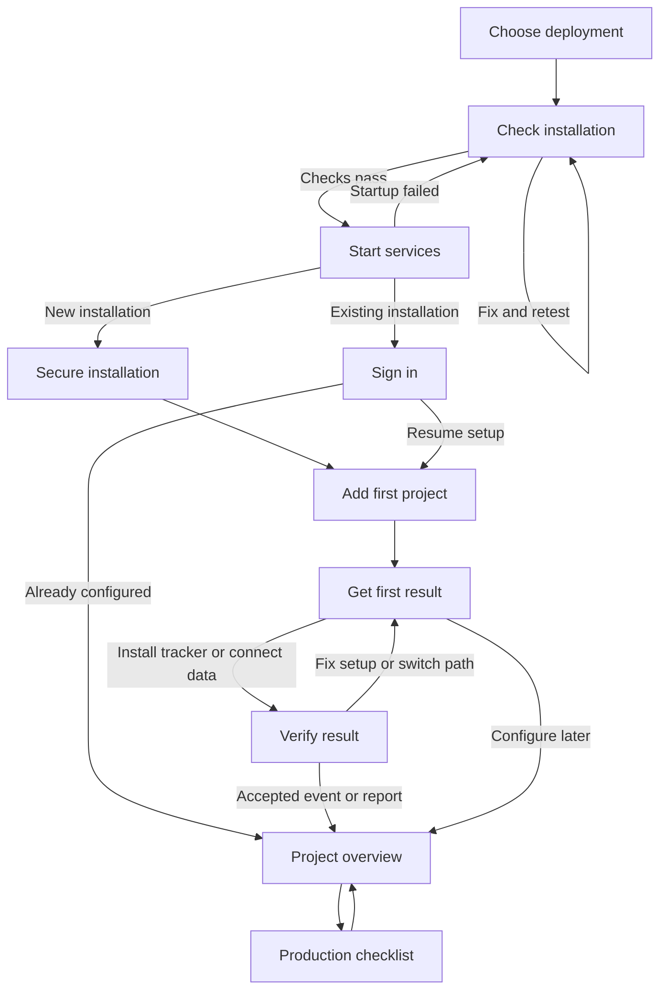
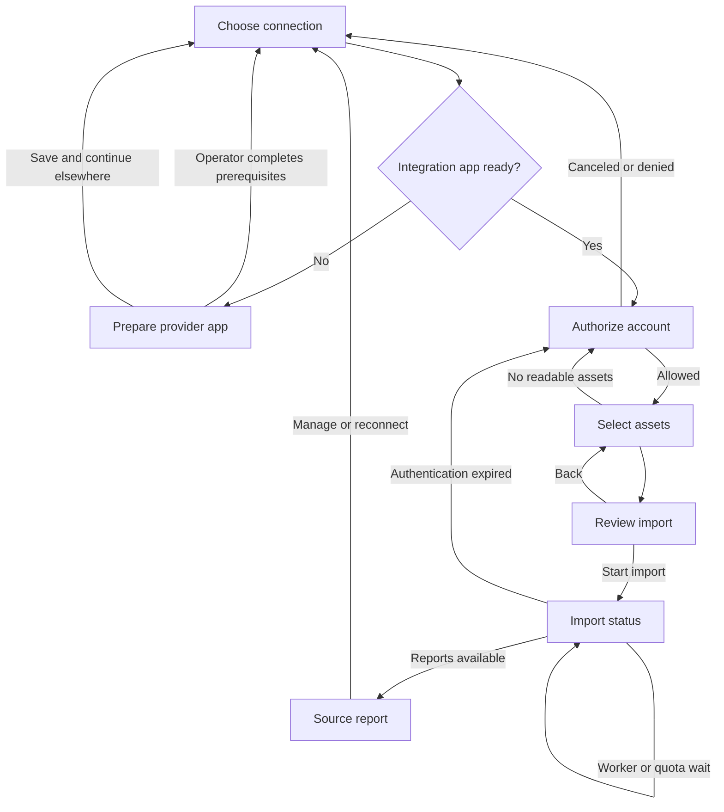
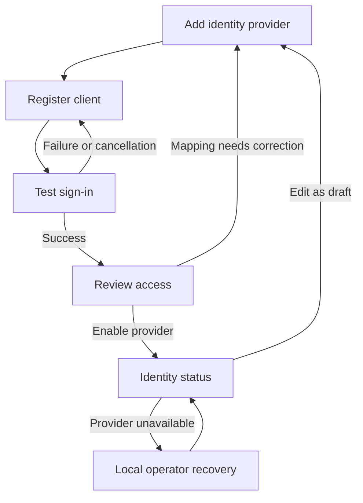

# Setup critique and native integration flows

Status: **design and implementation plan**, 2026-10-12. No installer, application, integration or usability test has been implemented. The owner chose native integrations; Zernio is not in the implementation plan. This refines the existing 81 V1 requirements rather than reducing parity or adding the optional features suggested in the earlier product discussion.

## Refined brief and critique method

“Super easy” needs observable outcomes: a new operator can deploy without editing source; a workspace administrator can connect an account without handling instance secrets; an analyst can distinguish missing setup from missing data. Preserve every V1 capability while asking for configuration only when its function is chosen.

Design Critique assesses usability, hierarchy, consistency and accessibility against the existing planning documents. UX Flow Wireframer supplies paths, recovery and screen sketches. Ponytail keeps one application, one database and the existing queue; no installation control plane, OAuth broker or plugin marketplace. GPT owns design and security decisions. Kimi supplied bounded wording suggestions for eight error states; GPT revised them. This is a document critique, not a visual or accessibility audit of a running interface.

## Findings and design decisions

| Finding in the current plan | Severity | Change and reason |
|---|---|---|
| Deployment instructions describe contracts, but the UI begins at owner claim | Critical | Add a versioned release bundle and an operator journey from machine checks to a verified result |
| Separate owner claim, sign-in and workspace screens repeat work | High | Claim and create the owner once, sign in automatically, create a renameable default workspace |
| OIDC, provider app registration, report credentials and browser pixel IDs can look like one settings task | High | Separate instance identity, integration app registration, workspace data connections and browser destinations |
| A generic Connect button hides external developer-app prerequisites | Critical | Show operator readiness before OAuth, with a precise handoff when registration or review is outstanding |
| OAuth success can be mistaken for reports being ready | High | Track authorization, selected assets, verified reads, import progress and report coverage separately |
| Full navigation presents many modules before there is useful data | High | Lead with one chosen outcome and a resumable checklist; retain module navigation and all capabilities |
| Provider settings can block project creation and first value | Critical | Manual project creation and native collection work with no paid accounts, OIDC or SMTP |
| “Healthy”, “connected” and “protected” can overstate evidence | High | Show app/worker/source health separately; a backup upload is not a tested recovery |
| Identity configuration can lock out the installing operator | Critical | Draft, test, preview membership, then enable; retain tested local recovery |
| A single progress percentage hides approval waits and partial imports | Moderate | Label the current stage, responsible person, observed evidence and next action |

What already works: the small Docker topology, separate public collector, evidence drawer, source-aware metrics, explicit budget controls and independent tag/import setup. Preserve those. The hierarchy should be **your project → your next result → evidence**, with deployment details visible only to operators. Contrast, responsive layout and actual focus behavior still need rendered implementation tests.

## Ownership and information architecture

| Surface | Who acts | What belongs here |
|---|---|---|
| Deployment configuration | Host operator | Database, durable encryption keyring, public URL, proxy trust, storage, process enablement |
| Instance settings → Identity | Instance operator | Local recovery and generic OIDC registration, approved issuer, membership policy |
| Instance settings → Integration apps | Instance operator | Deployer-owned OAuth application IDs/secrets, callback URLs, provider approval readiness |
| Workspace → Connections | Workspace admin with connection permission | Authorize native accounts, select properties/assets, assign projects, choose import scope and schedules |
| Project → Tracking | Project admin with publish permission | Browser destinations, public tag IDs, consent/event mappings, preview and publish |
| Project overview | Analyst | Available reports, coverage, stale data and a specific next action |

Keep report credentials server-side. App registration can be reused by the instance, but tokens, assets and effective permissions remain workspace-scoped. A workspace admin cannot read another workspace's connection or the operator's client secret. A report connection never enables a pixel. Identity login never authorizes Google or Meta data imports. Viewers see a setup explanation and the responsible role, not secret fields or working admin actions.

Offer a searchable connection catalogue using user vocabulary: **Website analytics**, **Search Console**, **Google Analytics**, **Meta ads**, **Google Ads**, **Search and AI research**. A provider detail page shows separate capabilities such as Import reports and Configure browser tag. Use the existing navigation shell; move connection management into one workspace surface and deep-link from Search/Tracking/Operations. Imported reports remain accessible from their module and shared measurement view.

## Flow A: deployment to a first result

User: an operator with Docker access; default assumption is a single host. Entry: release instructions or reopening an existing installation. Success: a real labeled test event is accepted, or an authorized source report is displayed with its coverage. A local test is not evidence that a remote website can reach the collector.

Publish one tested release bundle containing pinned image coordinates, Compose files, a minimal configuration template and topology-specific instructions. A proposed same-image setup command creates the required configuration and secrets in an explicitly mounted operator-owned directory. It must not mount the Docker socket or orchestrate the host from the web app. A short documented host-side sequence runs preflight/setup, an explicit migration, and service startup. These are planned command responsibilities, not commands users can run today.

The default stack remains web + worker + PostgreSQL, with the same application image for web/worker/migrate/setup/diagnose. Optional components appear only for the selected browser/proxy/storage mode. Release templates support existing HTTPS proxies and one optional bundled Caddy recipe; no automatic DNS edits. Caddy requires suitable DNS, reachable challenge ports or a deliberately configured alternative, and persistent certificate state. [Caddy automatic HTTPS](https://caddyserver.com/docs/automatic-https)



| Screen | Intent / minimum input | Primary action | Failure, cancellation and resume |
|---|---|---|---|
| Choose deployment | Try locally OR deploy for a team; public hostname and existing/bundled HTTPS only for team mode | Prepare setup | Advanced external DB/storage optional; previous answers retained |
| Check installation | Supported Docker/Compose, architecture, selected ports, writable storage, disk, selected network mode | Run checks | Name failing prerequisite and repair; resource guidance must come from measurements |
| Start services | Initialize durable secrets once, connect DB, migrate, verify schema and local storage | Start services | Bounded retries; stopped worker visible; failed migration blocks incompatible processes |
| Secure installation | One-time operator token, owner email/password; recovery instructions | Create owner | Atomic single claim; expired token regenerated locally; password/token never in URL or ordinary logs |
| Sign in | Existing local/OIDC account; shown only for returning installations | Sign in | Use documented recovery; never reopen bootstrap after a restart |
| Add first project | Name, website and confirmed timezone; default workspace rename is optional | Create project | Validate locally; paid website research optional after project exists |
| Get first result | Choose Track website, Import existing reports, Connect search data, or Audit website | Continue | One selected outcome, no mandatory provider checklist; Configure later remains visible |
| Verify result | Relevant tracker diagnostics or selected-source read/import evidence | Verify setup | Retest, edit or switch outcome; local sample events labeled and excluded from production totals |
| Project overview | Show available evidence and remaining setup | Inspect result | Empty overview links to saved setup; no fabricated demo metrics |
| Production checklist | Public origin/TLS, backup destination, recovery material and restore status | Review next task | Optional services do not block unrelated functions; unfinished recovery work stays visible |

First public-site path has four browser screens after services start: Secure installation → Add first project → Get first result → Verify result. The default workspace is created during owner claim. Other paths have different steps; do not advertise this count as total provider onboarding effort. Creating an owner must not re-request sign-in unless a policy requires an additional authentication factor.

Choose deployment, Check installation and Start services are **host-side release instructions and plain terminal prompts**, not screens served by the application. Their boxes below are logical sketches, not a new terminal UI framework. The handoff to the browser occurs at Secure installation or Sign in after services are running. Docker/port checks run on the host; the same-image helper checks application configuration and writes only to its explicitly mounted setup directory. No privileged installer service is introduced.

```text
Choose deployment                 Check installation / Start services
+-------------------------------+ +---------------------------------------+
| Set up ten98-monitor          | | Installation checks                   |
| ( ) Try on this computer      | | Docker / storage / database [status]  |
| ( ) Deploy for your team      | | Public address [pending verification] |
| App address [              ]  | | Worker [waiting for migration]        |
| HTTPS [Existing / Bundled]    | | [Run checks]                          |
| Advanced database and storage| | Then: [Start services]                |
| [Prepare setup]               | | Exact repair steps, no endless spinner|
+-------------------------------+ +---------------------------------------+
Secure installation / Sign in     Add first project
+-------------------------------+ +---------------------------------------+
| Secure this installation      | | What website do you want to monitor?  |
| Setup token [hidden]          | | Name [Example Store]                  |
| Email [ ] Password [hidden]   | | Website [https://example.com]          |
| [Create owner]                | | Timezone [Asia/Dubai]                  |
| Returning install: Sign in    | | Workspace [My workspace] optional edit|
| Local recovery instructions   | | [Create project]                      |
+-------------------------------+ +---------------------------------------+
Get first result                  Verify result
+-------------------------------+ +---------------------------------------+
| What would you like to see?   | | Website tracker                       |
| (*) Website visits            | | Copy snippet · Open installation guide|
| ( ) Existing advertising data | | Allowed host / CSP / received event   |
| ( ) Search data  ( ) Audit    | | [Verify setup]                        |
| [Continue]   Configure later  | | Or: report source, dates, import state|
+-------------------------------+ +---------------------------------------+
Project overview                  Production checklist
+-------------------------------+ +---------------------------------------+
| Example Store                 | | Ready for your team?                  |
| First result [Inspect result] | | HTTPS [verified / needs attention]    |
| Coverage and last updated     | | Backup [available / not configured]   |
| Resume setup                  | | Restore [not yet verified]            |
| Connected sources [Manage]    | | [Review next task]                    |
+-------------------------------+ +---------------------------------------+
```

Local mode binds to loopback and includes a deliberately invoked test page; it is not a public production collector. An HTTPS website must not be instructed to send to an unreachable localhost endpoint. Some providers permit local OAuth callbacks; each recipe states its actual requirements. Production URL changes are deliberate operator changes that regenerate callback instructions and require affected connection retests.

Setup is idempotent and resumable. Existing database/key state must never silently generate a new key or owner. Missing encryption keys stop setup with a restore instruction. App-level schema checks remain mandatory even when a platform ignores Compose dependency conditions. [Docker startup ordering](https://docs.docker.com/compose/how-tos/startup-order/)

Deployment settings stay in the selected secret/config source; routine optional credentials are edited in the authenticated UI and encrypted in the database. If an operator supplies an environment/file-managed value, show “Managed by deployment configuration” instead of accepting a competing UI value. Secret-file mounts are supported; source files still need host protection. [Compose secrets](https://docs.docker.com/compose/how-tos/use-secrets/)

## Flow B: native accounts and imports

User: instance operator for app registration; workspace admin for connection. Entries: Connections catalogue, a module's empty state, or reconnect action. Success: the chosen account's report is available with dates and provenance. Credentials accepted and OAuth returned are intermediate states.



| Screen | Primary action | Minimum decision and recovery |
|---|---|---|
| Choose connection | Connect account | Choose capability; show prerequisite owner and each independently ready dataset |
| Prepare provider app | Check configuration | Operator copies callback, follows current provider registration recipe, enters client credentials; users get a setup handoff without secrets |
| Authorize account | Continue to provider | Explain requested permissions and ten98's actual operations; canceled/partial consent preserves draft |
| Select assets | Continue | Display identity, account owner, stable ID, currency/timezone where returned; explicit workspace/project assignment, no silent select-all |
| Review import | Start import | Show selected datasets, dates and permissions; proposed initial 7-day window within provider limits, optional backfill, no enabled pixel |
| Import status | View available report | Per-source progress and coverage; no ETA without evidence; pause/retry/reconnect retains cursor and completed work |
| Source report | Inspect report | Source/timezone/currency/attribution/freshness and missing coverage; empty successful query differs from failed import |

```text
Choose connection / Prepare provider app
+-----------------------------------------------------------------------+
| Connections / Meta ads                                                |
| Import advertising reports       Instance app: Setup needed           |
| Operator task: register your Meta app and configure the callback      |
| Callback [generated exact URL] [Copy]  [Open provider instructions]    |
| Operator only: App ID [ ]  App secret [hidden] [Check configuration]   |
| Workspace admin: [View setup handoff]   Continue with another source   |
+-----------------------------------------------------------------------+
Authorize account / Select assets
+-----------------------------------------------------------------------+
| Connect Meta ads to Example Agency                                    |
| Reporting access requested · Campaign editing is not a ten98 action   |
| [Continue to provider]                                                |
| After authorization: identity, business, account name and account ID  |
| [ ] Example Store ads · account ID · source currency/timezone          |
| Assign to project [Example Store]                         [Continue]  |
+-----------------------------------------------------------------------+
Review import / Import status / Source report
+-----------------------------------------------------------------------+
| Import Meta advertising reports                                      |
| Account [selected ID] · Project [Example Store] · Dates [last 7 days]  |
| Data: campaigns, spend, impressions, clicks, available conversions     |
| Pixel installation: unchanged. Recurring import: off until selected.  |
| [Start import]  Back                                                  |
| Import: account access verified → 2/4 dates complete                  |
| [View available report] · Waiting dates remain unavailable, not zero  |
+-----------------------------------------------------------------------+
```

The operator performs developer-app registration once per configured provider app, not once per project. No embedded shared ten98 secret or required central OAuth broker. Store credentials encrypted, bind OAuth state to the initiating session/workspace/provider, and recheck authorization on callback and job dispatch. Generate callbacks from the trusted deployment origin, not request Host headers. Reconnect preserves connection identity and selected assets; switching to another upstream account requires explicit selection. Use vetted OAuth libraries and provider-specific contracts, with state, exact redirect validation and PKCE where supported. [OAuth security BCP](https://www.rfc-editor.org/rfc/rfc9700.html)

### Provider recipes and truthful readiness

| Provider | Operator recipe | Workspace recipe / recovery |
|---|---|---|
| Meta / Facebook ads | Own developer app and Marketing API setup; distinguish own assets from other businesses' assets; show applicable approval prerequisites and exact callback | Request `ads_read` for reports; broader discovery permissions only for justified endpoints. Empty accounts explains wrong identity, missing assignment, denied permission or app access restriction |
| GA4 | Google project, enabled Data API and Admin API if discovering properties, web OAuth client, consent configuration | `analytics.readonly`; choose property by name and numeric ID. Measurement ID is not report access |
| Search Console | Enable API and configure Google OAuth application | `webmasters.readonly`; choose Domain or URL-prefix properties explicitly. Canonical domain authorization does not authorize other registered-domain aliases |
| Google Ads | Enable API and obtain suitable access for the Google Cloud project owning OAuth credentials | Select accessible customer/manager context and test production-account access; preserve manager login context |
| Other accepted ad platforms | A maintained native setup recipe per platform, with current scopes, callback requirements, account eligibility and approval evidence | Same choose/authorize/select/read/import flow, adapted to actual auth method; no generic form that requests every possible credential |
| Cloudflare reporting | Token recipe for the selected GraphQL dataset/account or zone | Select exact asset; test permitted dataset and show sampling/history limitations; independent of beacon setup |
| OpenRouter / DataForSEO | BYOK setup and explicit spend permissions | Save key, use a free validation endpoint where available; any billable test shows estimate/cap and requires confirmation |

Meta's official collection distinguishes access to one's own ad accounts from access to other businesses' accounts. Show approval state as **operator-declared** unless a supported API verifies it. Exact app type, review and business-verification steps must be rechecked for the supported endpoints at implementation; main Meta documentation could not be fully fetched during this review. [Meta Marketing API collection](https://www.postman.com/meta/facebook-marketing-api/documentation/0zr4mes/facebook-marketing-api-mapi), [Meta SDK prerequisites](https://github.com/facebook/facebook-nodejs-business-sdk)

Use current Google recipes: [GA4 Data API](https://developers.google.com/analytics/devguides/reporting/data/v1/quickstart), [property discovery](https://developers.google.com/analytics/devguides/config/admin/v1/rest/v1beta/accountSummaries/list), [Search Console authorization](https://developers.google.com/webmaster-tools/v1/how-tos/authorizing). Google external OAuth apps in Testing normally have seven-day refresh tokens for these non-login scopes; show a development-state warning and production configuration steps. Publishing is not proof that all required verification is complete. [Token lifecycle](https://developers.google.com/identity/protocols/oauth2), [OAuth production verification](https://developers.google.com/identity/protocols/oauth2/production-readiness/sensitive-scope-verification)

As checked on 2026-10-12, Google Ads developer tokens were sunset on September 9, 2026; access is attached to the OAuth credential's Cloud project. Do not ask for an obsolete token or copy the page's stale summary over its current migration text. [Current Ads onboarding](https://developers.google.com/google-ads/api/docs/api-policy/developer-token), [access levels](https://developers.google.com/google-ads/api/docs/api-policy/access-levels)

Google Ads uses a broad `adwords` OAuth scope. Say **“ten98 imports reports only”**, not “Google grants read-only access.” Enforce an endpoint/method allowlist and use an appropriately limited upstream account role where possible. GA4 and GSC have their own read scopes. Google login, GA4, GSC and Ads each expose their status even when they share registration. [Ads OAuth scope](https://developers.google.com/google-ads/api/docs/oauth/internals), [manager account context](https://developers.google.com/google-ads/api/rest/auth)

Avoid asking for a live token as a support workaround. A scope check plus a successful read of the selected account establishes verified access; authorization alone does not. Record API version, source and checked date in each recipe and add release-time refresh of instructions to TRK-01. External approval waiting time is separate from installation time.

## Flow C: OIDC without locking out the operator

User: instance operator; workspace admins may configure authorized membership mappings but cannot change the trusted instance issuer. Entry: Instance settings → Identity. Success: a tested OIDC identity receives exactly the intended memberships and the existing recovery path still works. Use generic OIDC with provider recipes for systems such as Entra, Google Workspace, Authentik and Keycloak; recipes do not imply separate identity engines.



| Screen | Primary action | Required information and recovery |
|---|---|---|
| Add identity provider | Discover settings | Provider recipe or generic issuer URL; use discovery instead of manually entering every endpoint; show issuer/TLS errors |
| Register client | Save draft | Copy callback into IdP, enter client ID/secret and supported authentication method; draft does not replace working config |
| Test sign-in | Test sign-in | Isolated authorization transaction while existing operator session remains; cancellation or failure returns to draft |
| Review access | Enable provider | Show redacted issuer/subject identity and proposed workspace/role mapping; require tested recovery; no membership or account linking committed by test |
| Identity status | Manage provider | Last tested time, enabled state, affected workspaces and recovery guidance; disable or rotate safely |
| Local operator recovery | Follow recovery procedure | Separate protected local account/host-assisted recovery; no unauthenticated bypass, default password or email-only takeover |

```text
Add identity provider / Register client
+-----------------------------------------------------------------------+
| Team sign-in: [Generic OIDC / provider recipe]                         |
| Issuer URL [https://identity.example.com/...] [Discover settings]       |
| Callback [generated exact URL] [Copy]                                 |
| Client ID [ ] Client secret [hidden]                                  |
| [Save draft]  Existing sign-in remains active                          |
+-----------------------------------------------------------------------+
Test sign-in / Review access
+-----------------------------------------------------------------------+
| Test your identity provider                                           |
| [Test sign-in]  No login policy changes are applied by this test       |
| Result: issuer verified / linked or unlinked identity / proposed access|
| Default: invited members only. Mapping preview: Example Agency Viewer |
| Recovery account tested [date]                           [Enable provider]|
+-----------------------------------------------------------------------+
Identity status / Local operator recovery
+-----------------------------------------------------------------------+
| Team sign-in [Enabled / Needs attention]                              |
| Last test [time] · Recovery account [configured]                       |
| [Manage provider]  Recovery instructions                              |
| Existing owner can use documented local recovery, then repair draft   |
+-----------------------------------------------------------------------+
```

Discovery validates exact issuer and metadata; the implementation must validate signed ID tokens, audience, nonce and expiry through an audited library. Bind identities by issuer + subject. Matching email alone must not merge accounts or grant membership. Default to invited members; claim/group mapping is explicit, tenant-scoped and tested for no unexpected admin grants. [OIDC discovery](https://openid.net/specs/openid-connect-discovery-1_0.html), [OIDC Core](https://openid.net/specs/openid-connect-core-1_0.html)

Existing local members link OIDC explicitly from Account → Sign-in methods: **Reauthenticate local account → Authenticate with OIDC → Review identity → Link identity**. Require recent local authentication (including configured 2FA) and a fresh validated OIDC transaction bound to that session; reject an issuer/subject already linked elsewhere. Cancellation returns to unchanged sign-in methods. An operator's configuration test does not perform this link. The review screen names the identity to be linked, uses one Link identity action and allows cancellation; failed proof returns to reauthentication.

For a new unlinked OIDC user, invitation acceptance requires a valid unexpired single-use invitation plus a validated identity and proof of the intended recipient. Where the IdP provides a trusted verified email claim, compare it to the invite recipient; otherwise use a separate recipient verification challenge or audited admin binding to the exact issuer/subject. A matching email without the invitation and proof grants nothing. If that email already belongs to a local account, require the explicit existing-account linking flow rather than auto-merging. Missing proof leaves the invite pending with a retry/admin-help path; no implicit workspace or admin assignment.

Private self-hosted issuers are legitimate but require an operator-only exact endpoint/network allowlist. Discovery, token and JWKS fetches must not become unrestricted SSRF or follow redirects to metadata services. Do not trust every private address or disable TLS verification to make setup pass. The local recovery path must be tested before changing sign-in policy.

Generic OIDC does not itself push immediate account deprovisioning. Document session lifetime, membership revalidation on sign-in and explicit local session/API-token revocation; do not claim that disabling a person in an IdP instantly invalidates all ten98 access. Offboarding remains an explicit tested operation, including machine credentials. Instance recovery access is not ordinary workspace membership.

## Supporting setup, errors and accessibility

Email uses the same save-draft → validate → explicit test → enable pattern, with SMTP/Cloudflare fields shown only for the selected transport. Explain sender verification and cost before sending. Core setup must work without email; provide an authorized, expiring invite-link copy action with intended-recipient checks, never public bootstrap or default credentials. Browser/gateway choices expose prerequisites only when a related job is selected; preserve old working configuration until replacement validation succeeds.

| State | User message / action |
|---|---|
| Local endpoint on a public site | “This address is only reachable on your computer.” → Open production setup |
| Missing Meta registration | “Your instance operator needs to configure Meta.” → View setup instructions |
| OAuth canceled | “Authorization was canceled. Your draft is saved.” → Resume connection |
| No readable accounts | “No accessible ad accounts were found for this identity.” → Check account access; secondary Switch account |
| Import pending | “Your first import is running. Reports will show the dates received so far.” → View import status |
| No rows in a successful query | “No data returned for these dates.” → Change date range; retain source coverage |
| Partial consent | “GA4 is ready. Search Console permission is missing.” → Authorize Search Console |
| OIDC draft test failed | “Sign-in test failed. Your current configuration is unchanged.” → Edit configuration |
| Credential expired | “This source needs authorization again. Your history is saved.” → Reconnect |
| Worker unavailable | “Your import is queued. The worker is unavailable.” → View worker status, or operator handoff for non-operators |
| External approval outstanding | “Provider approval is still required.” → Open provider instructions; continue elsewhere |

Every screen has one primary CTA and an escape/back path. The action shown is permission-aware. Empty means no configured item/data; loading shows the current durable stage without inventing progress; errors retain safe draft fields and specify a recovery action; success states describe observed evidence. Never retain secrets in localStorage or carry OAuth/bootstrap tokens in saved return URLs. Password-manager-compatible controls, copy buttons, labeled secret visibility toggles, paste, keyboard operation, visible focus, accessible error summaries, live status announcements and mobile reflow are required. Do not communicate state by color alone. Provider redirects return to the originating wizard after session/workspace checks.

## Upgrade, restore and handoff

The operator screen presents topology-specific instructions, not a web button with host privileges. Upgrade: review compatibility → pause dispatch → coordinated backup → pull pinned image → migrate → start → check login/collector/worker/reports → explicitly resume. Existing compatible image rollback and checkpoint restore are different paths. Routine instructions never delete volumes.

Restore starts with outbound imports, paid schedules, email and tag publishing paused. Verify database, artifacts, original keyring, new external origin, account ownership and tag configuration epoch before selecting what resumes. Show backup age and the date/evidence of the last restore drill separately. A local diagnosis command emits a redacted summary; support export requires preview and excludes credentials, raw customer reports, prompts/replay and internal network details by default.

Map operator errors to the existing deployment lessons: D01 spending, D02 network isolation, D03/D04 identity/offboarding, D05 recovery keys, D06 importer semantics, D10 owner claim and D12 provider/worker blocking. These are documented lessons in [deployment.md](deployment.md#deployment-lessons-and-product-gaps), not newly observed incidents. The proposed setup experience is their design response.

## Implementation acceptance and usability study

These checks refine P01–P04/P08/P10/P57–P58/P63–P69/P71/P76/P78/P81. The register remains 81 rows; none passes from documentation alone. Work packages are in [roadmap.md](roadmap.md#deployment-and-onboarding-backlog).

1. Fresh local install reaches a labeled test event with no external credentials or paid requests. Fresh production install reaches verified HTTPS and an accepted event from a separate HTTPS site.
2. Rerunning setup preserves owner, keyring, data and published configuration. Missing original keys, DB failure, occupied port and incompatible migration each stop safely with a usable recovery path.
3. Test vanilla Compose, the documented importer and two side-by-side instances; schema/worker controls remain correct when dependency/profile semantics are dropped.
4. Closing/reopening each wizard resumes after authentication; cancel/back/duplicate submission cannot create duplicate owners, connections, imports or paid jobs.
5. Workspace users cannot configure instance client secrets; callback/workspace swapping, foreign asset selection, stale roles and unauthorized job dispatch fail server-side.
6. Meta/Google and each other required import adapter pass a real controlled selected-asset read, refresh after restart, partial-consent, expired/revoked access and empty-account case. Fixture-only coverage cannot pass integration parity.
7. Report-only setup leaves pixels unchanged; tag-only setup requires no report OAuth; pending approval affects only its dependent capability. Broad provider scopes are accurately described and connector methods restricted.
8. Reconnect/rotation preserve selected accounts and history, compare identities and reject unexpected asset replacement. Partial backfills stay visibly incomplete; retries do not duplicate snapshots.
9. OIDC test does not change membership, account links or active policy. Wrong issuer/audience/nonce, unsafe metadata endpoints, email collision, stolen/replayed invite, unverified recipient, already-linked identity, group privilege escalation, IdP outage and explicit offboarding pass independent tests; explicit linking requires both authentication proofs and recovery still works.
10. URL/proxy changes produce the correct callbacks and documented reconnection guidance. Secret/config source precedence, token rotation and localStorage/log redaction pass checks.
11. Upgrade and clean-host restore retrieve sample records and decrypt credentials while outbound actions remain paused until revalidated. Backup success alone never marks restore verified.
12. Keyboard, screen reader, 200% zoom/360px reflow and supported locale/RTL walkthroughs cover deployment handoff, connection wizard and OIDC recovery; no inaccessible provider-dependent dead end.

Before calling setup “easy”, observe five representative first-time participants: self-host operator, agency operator, workspace admin, analyst and an accessibility-focused participant. Include at least two people who have not used the project. Tasks: local/public setup, provider connection, expired connection recovery and OIDC draft failure. Record active time, external approval wait, errors, undocumented help and completion separately. Proposed targets: four of five complete their assigned core task without undocumented help; local setup within 10 active minutes after Docker/image download, public setup within 20 after DNS/TLS prerequisites, and account connection within 3 after operator registration and permissions are ready. These are hypotheses to test, not marketing claims or guarantees. Do not hide external approval work from end-to-end measurements.

Open implementation decisions: measured host sizing and recovery targets, final tested auth library/license, actual provider approval test accounts, and retention deletion defaults already awaiting owner confirmation. Provider recipes need release-time verification. No new decision is required to finish this plan; ask before dependent implementation where the existing brief requires it.
