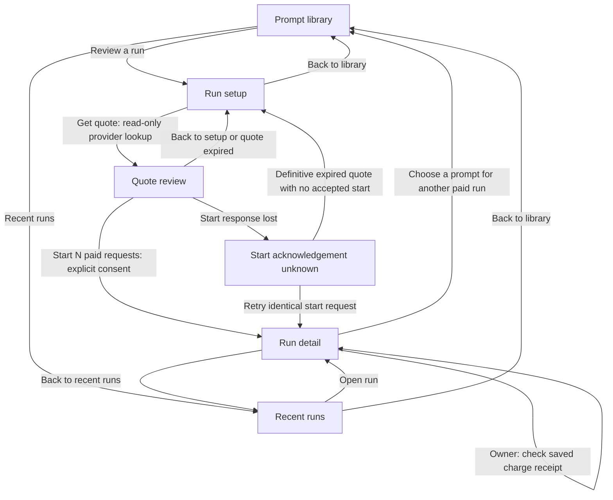

# Prompt execution UI contract

Status: the execution backend, metadata boundary and manual interface are implemented. The [integration record](research-ui.md) and [public production-browser harness](../tests/research-ui/README.md) document synthetic acceptance. Desktop/360px answer layouts, immutable version selection, library return state/focus, costs, expiry, lost acknowledgements, cancellation, stale responses, permissions and reconciliation passed against real local routes and receipts. GPT inspected the rendered answer screens. No live-provider compatibility, full AI visibility parity or accessibility certification is claimed.

## 1. Goal, reference patterns and critique

User: a signed-in owner/admin/editor reviewing a saved project prompt on desktop or mobile; viewers inspect retained runs. Goal: deliberately obtain one or two model answers and understand the incurred or unresolved charge. Success: the selected immutable prompt version and explicit optional system message are quoted, approved once, and lead to a readable outcome with honest charge and retention states. Saving, enabling, visiting or refreshing a prompt never sends a model request.

Use the existing Research → Prompts destination. No additional sidebar page, dashboard shell, UI framework, model browser or chat interface. This is a bounded manual execution UI, not completed AI visibility parity. Scheduling, result cache, other model/provider routes and visibility scoring stay visibly unavailable rather than being simulated.

Apply the source patterns already recorded in `docs/interface.md` and `docs/research.md`: Elmo's project-scoped prompt/version and response inspection, Umami's compact hierarchy and readable evidence detail, OpenSEO's persistent project context and progressive setup. This is an original interface using the existing cool-neutral/violet shell, not copied upstream code or a claim of new upstream runtime research.

| Current issue | Impact | Design decision |
|---|---|---|
| Saving a prompt can be mistaken for permission to run it | Users may expect automatic tracking or hidden spending | The library says saving does not run prompts; the execution surface requires quote review and a separate deliberate Start action. |
| Library already contains filters, bulk entry, edits and history | Adding a second full form below everything creates a long, unclear page | Use an inline execution detail surface within Prompts, with a clear Back to library action; preserve the library's filter state. |
| A generic Run button could hide two charges | User cannot distinguish a saved preference from permission to spend | Row action is “Review a run”; the only paid CTA appears after an explicit quote review. |
| “Failed” alone says nothing about cost | Users could repeat charged requests | Present answer state and charge state separately; uncertainty has no automatic paid retry. |
| Run history needs an identifiable authored version and current cancellation permission | Model/time rows alone are ambiguous and client permission guesses are unsafe | Use the implemented immutable preview and server-computed cancellation metadata in section 7. |
| Small charges rounded to cents appear as zero | Misleading billing feedback | Display server decimal USD strings without Number conversion or cent rounding. |

What already works: immutable prompt versions, project/account keyed remounts, server budget gates, same-request retries, native sidebar links, and the existing Providers and spending page. Reuse them. No duplicate credential or budget forms in Prompts. Actual contrast, focus, mobile layout and overflow require rendered browser acceptance; this design does not certify them.

## 2. Placement and integration seam

Retain the Prompts page title, existing library and its CRUD/history behavior. Add a secondary “Recent runs” action beside Add prompt. Add “Review a run” for each unarchived saved prompt when the current user may write; it uses that row's `currentVersionId`, never an unsaved edit. In version history, “Review this version” may use that immutable version while the parent prompt is unarchived. A saved `enabled:false` preference does not prohibit an explicit run. Archived prompts remain readable but cannot be quoted.

Opening an execution surface swaps the library body for one focused surface under the same Prompts shell, rather than adding another navigable page. “Back to library” restores the invoking control's focus when it still exists. Preserve library filters and pagination in memory. Reuse the existing discard guard before leaving a dirty edit; never silently turn its draft text into a run. Do not change the URL allowlist: workspace/project/view=prompts remain the only relevant search state; prompt text, quote input, request keys and response bodies never enter URLs or browser storage. Opening an internal run detail is not a public share.

Proposed component boundary for a bounded Kimi draft (GPT wires its integration):

```ts
type ExecutionEntry =
  | {kind: 'configure'; promptId: string; versionId: string; authoredText: string}
  | {kind: 'history'};
type Props = {
  workspaceId: string; projectId: string; userId: string;
  entry: ExecutionEntry; onBack: () => void; onUnauthorized: () => void;
};
// export function PromptExecutionsPanel(props: Props)
```

Key the inner execution surface by userId+projectId, and a new entry intent must invalidate previous detail/quote operations. The parent must either remount on each deliberate entry change or pass a monotonic entry generation. Do not derive identity from a prompt's text. GPT owns the small PromptsPanel integration and workspaceId prop in index. The legacy capability copy and server DTO boundary are already implemented. Kimi initially owns only `src/components/PromptExecutionsPanel.tsx`, using `api`, `ApiError`, `errMsg` and existing styles; no shared app edits, new dependencies or CSS framework.

Owners get an ordinary TanStack Link to Providers and spending, preserving authorized workspace/project and changing view to `providers`. Nonowners see “Ask a workspace owner to configure this connection or spending limits,” not a forbidden link. No credential input or automatic connection check is added here.

## 3. Flow

Exactly three deliberate actions from an existing saved prompt: Review a run → Get quote → Start N paid requests. Selecting a model or editing text never starts a request. Start is not hidden behind a native confirm dialog; the visible review itself is the confirmation.



| Surface | User intent / primary action | Empty, loading and failure recovery |
|---|---|---|
| Run setup | Choose connection, one/two models, optional system text and output allowance; Get quote | Loading readiness shows a status, not an empty connection list. Missing vault/connection/check/budget gives the existing owner setup link or owner-help copy. Errors keep the draft. |
| Quote review | Read exact rendered messages, per-model and total reservation, then Start N paid requests | Quote retrieval failure returns to setup with the draft. Expired unused quote disables Start and offers Get new quote. Changing any input invalidates the quote. |
| Start acknowledgement unknown | Recover whether this exact start was accepted; Retry same start request | Freeze the original quoteId/requestKey body. Do not generate a new key, new quote or automatic retry. Explain that work may already have started. |
| Recent runs | Inspect latest 20 project comparisons; Open run | Empty: “No prompt runs yet. Choose a saved prompt to review your first run.” A failed GET has a Retry action, never “No runs.” No unimplemented pagination or history filter. |
| Run detail | Read per-model answer and charge, with Refresh status as the normal primary action while active | Actions and recovery depend on the state table below. An expired payload is an explicit state. Provider outcomes are not global app errors. |

Wireframes use illustrative amounts, never seeded production data:

```text
RUN SETUP
< Back to library                     Review a prompt run
Authored prompt version
  Which reporting tools suit a small team?  [read-only, full text]
Connection  [Team OpenRouter v]        Check passed
Models      [x] GPT-4o-mini  [ ] GPT-4o
Maximum output tokens [1024]           Allowed: 16–4096
> Optional system message [empty by default]
  Project context is not added automatically.
[ ] This connection uses OpenRouter funded credits.
    Upstream BYOK invoices are outside this app's supported billing route.
[Get quote]                            Back to library

QUOTE REVIEW
< Back to setup                        Review before spending
Reserve USD 0.019815                   Valid until 14:35:00 [local zone]
GPT-4o-mini · OpenAI                   USD 0.019815 reservation
Exact request                         [messages shown in role order]
  System: No system message           [absence, not an invented message]
  User: Which reporting tools suit a small team?
Maximum output tokens: 1024 · OpenRouter funded credits · No fallback
Actual credit charges may be lower. This is a conservative reservation,
not an invoice guarantee; taxes, credit-purchase fees and BYOK invoices are excluded.
[Start 1 paid request]                 Back to setup

RECENT RUNS
< Back to library                      Recent runs          [Refresh]
Authored prompt version       Models          Started       Outcome
Which reporting tools…        Mini + 4o       14:30         1 needs charge review
                                                            [Open run]
Latest 20 project comparisons. Prompt-library filters do not filter this list.

RUN DETAIL
< Back to recent runs                  Prompt run          [Refresh status]
Authored prompt version: Which reporting tools…
Started 14:30 · 2 model requests       [Stop remaining requests if allowed]
Prompt / system input                 [native disclosure]
+ GPT-4o-mini · OpenAI -------------+ + GPT-4o · OpenAI ----------------+
| Answer received                   | | Charge unconfirmed              |
| Reserved USD 0.019815              | | Reserved USD 0.321024            |
| Credit charge USD 0.000013         | | Credit charge: Unknown          |
| Answer as plain, wrapped text     | | No supported answer available   |
| Reported citations [safe links]   | | [Check charge receipt] owner    |
+-----------------------------------+ +----------------------------------+
Spending is paused until an owner reviews the unresolved charge.
```

On mobile these are one-column surfaces, with one model card after the other. History may use a bounded horizontally scrollable table with readable minimum cell widths; the viewport itself must not overflow. Avoid a modal, sticky action bar that covers content, or a dashboard metric grid of invented visibility scores.

## 4. Detailed behavior and copy

Setup defaults: no implicit system text, one model selected (GPT-4o-mini if in the server's supported list), maximum output 1024. Connection is unselected unless exactly one available connection exists; still visibly name it. List all connection check states; only `checkStatus:'ok'` is selectable for quoting. The funded-credit acknowledgment starts unchecked and is required before sending `fundedCredits:true`. Do not infer that a successful account check proves funded credit, token capacity, external-invoice control or execution permission. Readiness GET sends no provider request; Get quote does read-only provider lookup. Vault unavailable or spending paused must block Start; quote may be inspected while paused, clearly labeled “An owner must enable spending before this can start.”

System message is optional, maximum 4000 JS string units, well-formed Unicode, no NUL/vertical-tab/form-feed; preserve exact content rather than silently trimming or inserting project context. Use a labeled textarea and server validation. Prompt text is the saved version; no editing inside execution setup. A user who wants a different prompt returns to the library. Models must be unique and drawn from the returned supported list; currently only the two specified below. Output count is an integer 16–4096.

Quote review renders the returned `quote.messages` and `quote.input`, not current form values. Show total USD reservation prominently adjacent to the paid CTA and each route's separate reservation. Keep six-decimal strings intact. Do not calculate financial amounts with floating point or describe the reservation as a guaranteed provider invoice cap. Optional route details may show exact per-token prices/capacities, but they are secondary to input, models and total. Explain that full prompt-capacity pricing makes the reservation conservative; do not invent a tokenizer estimate. Quote expiry is a local display of the server timestamp; the server remains authoritative. Check expiry again synchronously before a first Start. Do not announce a countdown every second to screen readers.

Create `{quoteId,requestKey:crypto.randomUUID()}` once at the first deliberate Start, synchronously lock before awaiting, and retain the exact body for a network/5xx-uncertain retry. A retry may complete an earlier accepted start or submit the still-valid original authorization; it never requests a new model attempt under a new key. Label it “Retry same start request” and explain this. Do NOT disable this recovery merely because the quote clock expired: the backend returns an already accepted identical start before its expiry check. Only a definitive rejected response may release that attempt. Do not invent a comparison ID or infer success from HTTP 202 without a valid body. No automatic POST retry in effects, timers, catch blocks or React remounts.

An unknown-start screen must say “This start may already have been accepted. Retry the same request, or inspect Recent runs before starting anything new.” Preserve its attempt while the component remains mounted. Explicitly leaving it explains that leaving does not stop server work and discards local retry controls. This bounded increment does not persist drafts/attempts or add a custom navigation blocker/router; reloading opens the authenticated Prompts page and users inspect Recent runs. A new paid run always requires a fresh quote and confirmation.

After a valid mutation response, render that returned comparison immediately rather than clearing it while awaiting a second GET. Refresh metadata later without replacing a newer selected run. Explicit Open run must GET detail; never treat list summaries (which omit results) as complete details. Poll only the selected queued/running comparison with application GET at most once every 5 seconds, one request at a time, while visible. Stop on terminal/no-active children, unmount, context/access change, or five minutes; keep a manual Refresh status action. Resume from a visible explicit refresh, not paid retries. Do not refresh quote/provider endpoints automatically. Poll failures preserve the last observation with “Status could not be refreshed” and do not claim cancellation.

| Run / data state | User-facing meaning and actions |
|---|---|
| queued + reserved | “Waiting for worker”; reservation shown; charge awaiting dispatch. Stop remaining requests only when `canCancel`. |
| running + dispatched | “Request sent”; actual charge pending. Stopping queued siblings does not abort or refund this child. |
| completed + result present | “Answer received”; exact charge separately shown. Empty `result.text === ''` says “Provider returned an empty answer,” not expired/unavailable. |
| failed + settled | “No supported answer”; still display actual charge, including a legitimate zero. No free-retry claim. |
| uncertain | “Charge unconfirmed”; actual null is Unknown, not USD 0. Show fixed diagnostic. An available answer may still be shown with this charge warning. |
| cancelled | “Not dispatched”; show no refund claim and no fabricated actual charge. |
| reconciled | “Charge confirmed”; original answer may be unavailable. A new answer requires a fresh paid quote. |
| resultExpired true | “Answer and citations expired under workspace retention.” Never an empty-answer message; do not reconstruct from cache. |
| inputExpired true | “Copied execution input expired under workspace retention.” Hide copied system/user messages; label retained short text ONLY “Authored prompt version.” Do not present authored text as recovered execution payload. |
| isByok true | “Unexpected upstream BYOK billing”; recorded credit charge excludes external provider billing. Keep pause/owner-review copy even if answer succeeded. |

Do not aggregate “total actual” while any charge is unresolved. Per-model values and a count of unresolved charges suffice. A provider diagnostic is plain text, not markup. `reportedCost` is separate original evidence, not a value to overwrite rounded app accounting. Do not display internal fingerprints, actor HMACs or credential revisions as UX requirements.

Cancel uses “Stop remaining requests” with adjacent “Requests already sent may still be charged.” It POSTs `{}` once; never call it merely on Close, route change or AbortController abort. A refreshed successful response may show a child already running: render that result without promising that everything stopped. Do not expose Cancel to viewers or noninitiating admins/editors; the server `canCancel` drives this.

Only a current owner may reconcile an uncertain run. If there is a saved generation ID, show “Check charge receipt” with “Read-only provider lookup; does not request another answer.” If no ID exists, explain that automatic matching is unavailable and keep the charge unresolved; do not offer a useless repeated lookup. A matched result leaves spending paused and offers the owner Providers and spending link. Inconclusive remains uncertain, retains the comparison, and displays the returned message without an automatic retry or invented refund. Original-key/revision 409 keeps this read-only result and explains owner action. Never automatically unpause spending or swap provider keys.

Render answers as plain React text with wrapping, never HTML/Markdown/iframe or auto-linked prose. Citation links come only from `result.citations`; independently allow only HTTPS URL with no credentials, use target=_blank plus rel="noopener noreferrer", and never fetch previews, favicons or remote media. Unknown/invalid links render as text or are omitted safely. No citations means “No citations reported.” Direct API responses are not claims about consumer ChatGPT behavior, live web search, ranking or brand visibility.

## 5. Scope, lifecycle and accessibility contract

Use the existing `api<T>(path,{method,body,signal})` helper; it sends same-origin cookies. Do not add bearer keys, an alternative fetch client or custom auth. `ApiError.status===0` and 5xx after a mutation may mean acknowledgment loss. All execution paths reject query parameters; encode IDs in paths only.

Every async completion, error and finally block checks mounted state, project/user scope and its captured intent/operation generation before updating state or invoking onUnauthorized. Abort old reads on selection changes; stale success, failure and 401 must not replace a newer run or sign out a later account. One synchronous operation ref blocks double clicks before React rerenders. Reads cannot race a mutation into stale replacement; abort/invalidate pending detail/list requests when mutating, then accept the mutation response only for the current scope. Do not let a poll overwrite an open quote/newer selection. Preserve exact attempt bodies across recoverable failures.

Current 401 clears all loaded results, draft input, quote, pending attempt, timers and calls the scoped onUnauthorized once. Current 403/404 clears protected execution content/actions and offers Reload access; do not assume a record-not-found error proves global logout. Current metadata role viewer clears unused quote/draft/start controls while retaining legitimately readable history. A start already accepted continues server-side regardless of lost UI access. Stale callbacks do nothing. Backend authorization remains decisive even if visible permissions become stale.

Use native controls, associated labels, fieldset/legend for models, type=button for non-submit actions, and visible focus. Each surface has one clear primary action, with row/library actions secondary. Focus the setup/review/detail heading after explicit transitions; on validation failure focus the first invalid control and connect its message with aria-describedby. Poll updates must not steal focus. Error alerts use role=alert; loading/success announcements use a concise polite status. Never place an entire answer or a ticking countdown in a live region. Disabled controls have adjacent explanations.

At 360px and 200% zoom: 44px touch targets, minimum-width 0 on flex children, wrapped model names/URLs/IDs, no page overflow, side-by-side model cards stacking without losing order. Any bounded answer scroller is keyboard reachable and labeled. Cite links have descriptive names. Refresh/cancel/reconcile must remain reachable without scrolling through a 250,000-character answer. Use existing card/row/field/btn/pill/banner/alert/table-wrap styles; avoid a new design system.

## 6. Implemented backend type and endpoint map

Base `/api/projects/${projectId}/prompt-executions`; cookie authentication, application Origin for POST, no query string. GET requires current project membership. Quote/start require owner/admin/editor; cancellation requires a writer who is initiator or owner; reconciliation requires owner. POST body limit 32768 bytes. Monetary fields are USD strings and dates are JSON ISO strings. Reservations and app-accounted actual charges have six decimal places; per-token route prices and original reported costs retain their returned precision and may use exponent notation. Do not coerce either form through floating-point arithmetic.

```ts
type Role='owner'|'admin'|'editor'|'viewer';
type Model='openai/gpt-4o-mini'|'openai/gpt-4o';
type RunStatus='queued'|'running'|'completed'|'failed'|'uncertain'|'cancelled'|'reconciled';
type ChargeStatus='reserved'|'dispatched'|'uncertain'|'settled'|'cancelled';
type QuoteInput={connectionId:string;promptId:string;versionId:string;systemText:string;
  models:Model[];maxCompletionTokens:number;fundedCredits:true};
type Message={role:'system'|'user';content:string};
type RouteQuote={model:Model;tag:'openai';providerName:'OpenAI';promptCapacity:number;
  completionCapacity:number;promptPrice:string;completionPrice:string;requestPrice:string;estimateUsd:string};
type Quote={id:string;createdAt:string;expiresAt:string;input:QuoteInput;messages:Message[];
  connectionName:string;routes:RouteQuote[];estimateUsd:string;explanation:string;cacheReused:false};
type Answer={text:string;resolvedModel:string;provider:string;finishReason:string;
  citations:{url:string;title:string|null}[];promptTokens:number|null;completionTokens:number|null;receivedAt:string};
type RunSummary={id:string;model:Model;provider:string;status:RunStatus;chargeStatus:ChargeStatus;
  estimateUsd:string;actualUsd:string|null;dispatchedAt:string|null;completedAt:string|null;
  diagnostic:string|null;resultExpired:boolean};
type RunDetail=RunSummary & {result:Answer|null;reportedCost:string|null;
  isByok:boolean|null;upstreamReportedCost:string|null;generationId:string|null};
type AuthoredPromptPreview={id:string;versionId:string;textPreview:string};
type ComparisonSummary={id:string;quoteId:string;createdAt:string;cancelRequested:boolean;
  prompt:AuthoredPromptPreview;canCancel:boolean;runs:RunSummary[]};
type ComparisonDetail=Omit<ComparisonSummary,'runs'> & {runs:RunDetail[];input:QuoteInput|null;
  messages:Message[]|null;inputExpired:boolean;cache:{reused:false;available:false}};
type ListResponse={role:Role;models:Model[];vaultConfigured:boolean;spendingPaused:boolean;
  connections:{id:string;name:string;checkStatus:'untested'|'ok'|'error'}[];
  comparisons:ComparisonSummary[];cache:{available:false};scheduling:{available:false}};
type QuoteResponse={role:Role;quote:Quote};
type ComparisonResponse={role:Role;comparison:ComparisonDetail};
type ReconcileResponse=ComparisonResponse & {
  reconciliation:{status:'matched'|'inconclusive';message:string}};
type PromptLibraryExecution={available:true;schedulingAvailable:false;nextRunAt:null};
```

| Method and suffix | Exact request | Current response |
|---|---|---|
| GET base | no body/query | `ListResponse` |
| POST /quote | `QuoteInput` | `QuoteResponse` |
| POST /comparisons | `{quoteId:string,requestKey:string}` | HTTP 202 `ComparisonResponse` |
| GET /comparisons/:id | no body/query | `ComparisonResponse` |
| POST /comparisons/:id/cancel | `{}` | `ComparisonResponse` |
| POST /runs/:id/reconcile | `{}` | `ReconcileResponse` |

There is no list pagination, lookup-by-request-key GET, quote GET, answer retry, scheduler enable or result-cache endpoint. Start idempotency is the same POST body, actor, project and quote. Starting another run from history returns to the library to choose a saved version; never rebuild an expired request from its preview. The existing `/api/projects/:projectId/prompts` list returns `execution:{available:true,schedulingAvailable:false,nextRunAt:null}`. This signals manual backend availability, not a completed execution UI or automatic scheduling.

## 7. Implemented metadata boundary and verification

The following additive metadata changes are implemented; they need no migration. They preserve the existing mutation authorization and request-idempotency rules.

1. Quote, detail, start, cancel and reconcile success envelopes return top-level `role:Role` from the freshly checked scope, matching the list response. The client does not need a second metadata request to discover the role returned by that operation. Backend authorization remains decisive for every later action.
2. Every comparison summary/detail includes `prompt:{id,versionId,textPreview}` from the exact immutable authored version joined through its quote. The preview is at most 160 Unicode code points, including complete supplementary characters. It survives copied execution-input expiry because authored versions have a separate retention policy. Label it only “Authored prompt version”; expired system/user message copies remain null and are never reconstructed from it.
3. Every comparison includes `canCancel`, computed under the existing workspace/project gate. It is true only for a current writer who is the workspace owner or initiating user, with at least one queued child whose charge ledger is reserved. Demoted initiators and noninitiating administrators cannot cancel. Terminal comparisons return false. This snapshot controls visible actions; the cancel endpoint rechecks actual authority and state.
4. The prompt-library capability is `execution:{available:true,schedulingAvailable:false,nextRunAt:null}`. Its copy states that saving prompts does not run them and automatic scheduling is unavailable. Existing prompt CRUD, archive/restore and immutable version history are unchanged.

Eight isolated PostgreSQL prompt-execution groups passed, including live cancellation metadata by role, demotion, exact authored-version binding, Unicode preview bounds, recovery of an accepted start after quote expiry, and authored preview after copied-input expiry. Existing charge, reservation, queue rollback, retention and reconciliation checks remained in place. These tests use synthetic local provider responses and make no live paid requests.

The existing production Context/Prompts browser checks also passed with blocked external traffic, covering editing, immutable versions, conflicts, lost-response retries, permissions and project/account isolation. A scoped mobile library-table fix preserves at least 200 pixels of readable prompt content and provides a labelled keyboard-scroll region with reachable row actions; desktop and 360-pixel screenshots were inspected. TypeScript, production build and diff checks passed. These results validate the existing library and metadata preparation, not the pending execution surfaces, polling, citation rendering or paid-run UI.

## 8. Required execution UI acceptance and handoff — pending

The execution UI must pass the following checks after implementation. GPT validates actual rendering and async security, using synthetic fixtures and blocked external traffic only. No live paid request is authorized by this contract. Existing navigation, provider and prompt CRUD/history acceptance must still pass.

1. Open Prompts, Recent runs, Refresh and version history: application GET only, zero provider requests/POST starts. Viewer can read but cannot quote/start/cancel/reconcile; editor sees only permitted cancellation; owner can stop another writer's reserved children. Current demotion clears controls and late responses cannot restore them.
2. Choose current or historical unarchived saved version, then edit that prompt elsewhere. Quote review shows the selected immutable text and optional exact system input, not current text or hidden project context. Archive/permission/key change produces a recoverable server rejection before paid dispatch.
3. Quote one then two models: returned per-model/total reservations retain six decimal precision; changed input invalidates Start. Unchecked funding acknowledgment prevents quote. Expired unused quote needs an explicit new quote; selecting a model never makes a call.
4. Double-click Start synchronously; assert one request key and one logical comparison. Hold/drop the accepted response, explicitly retry identical body, prove one server comparison. Advance expiry before retry and recover the existing comparison. Never generate another key or POST in a timer/effect.
5. Hold quote/detail/list/poll responses, switch run/project/account A→B→A and deliver stale success/401/403 in reverse order. No cross-scope text, lost newer selection, or newer-session logout. Canceling a browser fetch or leaving detail sends no server cancellation.
6. Show queued/running/completed/charged-failed/uncertain/cancelled/reconciled and mixed two-child states. Stop remaining requests must not claim refund for the dispatched child. A matched charge remains paused; an inconclusive or missing-ID charge stays unknown and makes zero paid requests.
7. Distinguish empty answer, unsupported answer, missing answer, expired result and expired input. Retained authored preview remains labeled correctly after input expiry; copied system/user payload remains absent even after reconciliation. Null cost never renders zero. Unexpected BYOK warns about the separate invoice.
8. Malicious answer HTML/Markdown remains inert text; prose URLs do not become reported citations; invalid protocols/credentialed citation links do not navigate. No remote preview/media/font requests. Two long answers, long URLs/IDs and an empty citation list remain readable at 360px and desktop.
9. Read-only foreground polling stops on terminal state, hidden/unmounted surface and the bounded observation window; requests never overlap. Poll error preserves known data with stale-status warning. Mutation response updates detail without an immediately required refresh that can erase it.
10. Keyboard-only quote/start/back/error recovery, focus restoration, meaningful headings/labels, polite status (no answer announcements), visible focus, 44px targets, 200% zoom and no viewport overflow. Existing library save/conflict/same-body retry and router Back/Forward/new-tab flows are unchanged.

Public source package for the eventual restricted draft: this approved/published contract, the implemented TypeScript type map above, public `src/lib/api.ts`, one small public existing styling example, and curated reviewed Ponytail/UX-copy skill contents. Maximum 900 seconds, 8 steps, verified K3 maximum thinking, Skill-only profile, output only the one allowed component. No private tests, environment, synthetic account data or unpublished source. Record observed duration/tool calls/result; do not infer savings. GPT reviews the draft and performs final validation. Launch only after the supervising agent verifies publication of the approved inputs and a quota reset. This document launches nothing.

Design methods: design critique and user-flow wireframing. The remaining implementation is the bounded execution component, its GPT-owned integration and the execution-specific acceptance above. The default output allowance is 1024 tokens; the server accepts explicit integers from 16 through 4096 and supplies no automatic default.
