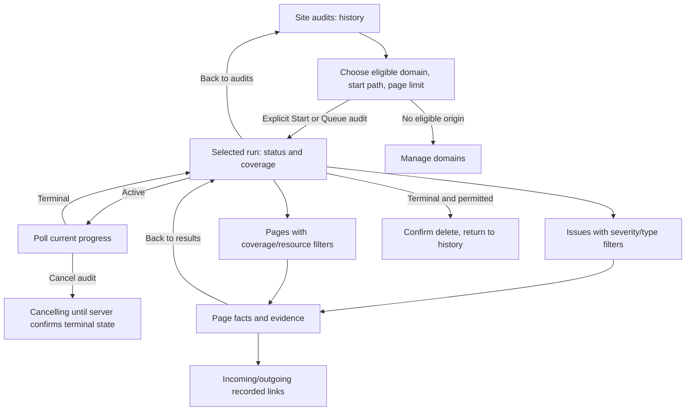

# Site Audit UI contract

Status: GPT-reviewed interface contract awaiting implementation, against the implemented manual static API/worker; no UI or browser acceptance claimed. This document authorizes no live crawl or Kimi launch. Full P53–P56 parity remains required: protected-site access, local/Cloudflare rendering, Lighthouse and lifecycle. Scheduling remains required too; unavailable capabilities must not appear as working controls.

## 1. Goal, source patterns and critique

Help project members understand what was checked, what needs attention and what could not be checked. Owners/admins start bounded audits; editors/viewers inspect. Success: choose an eligible domain, understand scope, follow progress and inspect issue evidence without mistaking an incomplete observation for a clean result.

Reuse [the original shell](interface.md): Umami compact summaries, OpenSEO persistent project context/history, Elmo measurement/configuration separation. Pinned OpenSEO source traces are in [research O2](research.md#o2-openseo-audits). No upstream code/assets are copied; keep existing system fonts, neutral/violet palette, native controls and panel styles.

| Critique | Severity | Concrete improvement |
|---|---|---|
| A generic score can imply complete site coverage | High | No invented health score, completion percentage or ranking claim. Put outcome, coverage and retained evidence beside counts. |
| A crawler form can conceal scope or network activity | High | Show exact origin and start path before one explicit Start audit action. Domain verification, selecting options and reading history never start work. |
| Missing evidence can look like a missing title or zero issues | High | Render unknown, not recorded, expired, truncated and observed empty values separately. |
| Setup controls and all evidence expanded make mobile unwieldy | Medium | Keep one focused history/run/page surface; collapse setup after history exists and secondary evidence groups by default. |
| An active run can appear stuck without context | Medium | Show actual phase, attempt/request counters, deadline and last successful refresh; offer Cancel audit using current server permissions. |
| Red/green alone hides meaning | Medium | Use text status and severity labels, native labelled controls and visible keyboard focus. Verify actual contrast and 360px layout in the browser. |

Reuse domains, permissions, receipts, pagination and retention. No parallel settings/credential form, table framework or dependency.

## 2. Navigation and component seam

Add **Site audits** after Google reports in **Measure**. GPT adds `audits` to the navigation allowlist/project-view set and ordinary TanStack links. All members may enter; management follows server role/capabilities. Title: “Site audits”; description: “Inspect technical SEO issues and the pages this audit could read.” Keep project origin/breadcrumbs.

URL state adds only `view=audits`; keep workspace/project IDs. Run/filter/draft/evidence state stays in memory, with no promised deep links or public shares. Preserve sidebar Back/Forward, mobile close and focus.

Bounded component seam:

```ts
export function SiteAuditPanel(props: {
  projectId: string;
  userId: string;
  onUnauthorized: () => void;
  onOpenDomains: () => void;
  onOpenRetention: () => void;
}): React.ReactNode
```

Key parent and inner panel by `userId + projectId`. GPT wires callbacks; Manage domains is owner/admin-only, Data retention is readable by members. Kimi owns **`src/components/SiteAuditPanel.tsx` only**. Reuse `api`, `ApiError`, `errMsg` and shared card/row/field/button/notice/alert/empty/table/pill classes. Scoped CSS requires separate review; no global edits/dependencies.

## 3. Flow and layout



| Surface | Primary action | Exit and state |
|---|---|---|
| History and setup | Start audit, or View audit once history exists | Selected project remains in shell; setup is a native disclosure, open for a new empty project. |
| Active run | Inspect observations; Cancel audit secondary | Back preserves selections; poll only selected active run. |
| Terminal run | Issues / Pages | Preserve filters; delete stays secondary. |
| Page detail | Inspect evidence/recorded links | Back to results restores invoking row focus if it still exists. |

Desktop sketch; values below are placeholders, never initial fake data:

```text
Site audits                                   Static HTML
> Start another audit                         [Refresh history]
Audit history
Started           Origin / start path       Outcome       [View audit]
[Load more audits]

< Back to audits
https://selected.example /start/              Partial
[Pages attempted] [Pages analyzed] [Findings detected] [Findings retained]
Coverage incomplete: [server reason explanation]
> Scope and limits       > Discovery / graph coverage
[Issues] [Pages]                              [Delete audit]
Severity [All]   Issue [All]                   [Apply filters]
Severity   Finding / observed detail          [View affected page]
[Load more issues]

< Back to results
/page/                    HTTP 200 · Analyzed · observed timestamp
Title and description     [plain recorded text or explicit state]
> Headings and content    > Canonical / robots    > Images / annotations
Recorded links: [Outgoing] [Incoming]
Kind       URL / source action        Anchor / status
[Load more links]
```

At 360px stack forms/metrics, wrap URLs, keep 44px actions and contain tables in labelled scroll regions. No hover-only meaning or nested modals. Use native disclosures and ordinary result buttons with `aria-pressed`; avoid incomplete ARIA tabs.

## 4. Setup, start and progress

On mount, read setup and first history page independently. Reading never crawls. A failed request offers Retry for that resource; it is not an empty project. Owners/admins see a form with:

- **Domain:** setup origins only; default canonical, otherwise first eligible. Labels: “Project origin” / “Verified serving domain”. Canonical is configuration, not DNS proof; redirect aliases are excluded. Empty: “No eligible HTTPS domain. Add and verify a serving domain to run an audit.” Offer Manage domains. If refresh removes the selected origin, require a new choice, never switch silently.
- **Start path:** default `/`; hint “Start with /. Queries and fragments are not supported.” Preview selected-origin URL as text. Reject empty/unrooted paths, `//`, query/fragment locally; maximum 2,048 characters, with server byte/URL safety validation authoritative. This is an entry point, **not a path-prefix restriction**: discovery may visit other paths on the exact origin.
- **Maximum HTML pages:** integer 1–1,000, default 50 from setup. “This is an attempt limit, not a promise that every page will be analyzed.” Show the 30-minute-from-creation deadline and maximum one request/second.
- Scope: “Static HTML on this origin only. Respects robots rules. Query URLs are excluded. JavaScript is not rendered.” Fixed request/body/frontier/link/sitemap ceilings belong in an operational-limits disclosure. No credential, rendered-mode or schedule controls yet. No paid provider API/key is used; hosting/network costs are not claimed free.

Primary action: **Start audit**. With unavailable worker and `canStart:true`, use **Queue audit**, preceded by “Worker unavailable. Queued audits expire 30 minutes after creation, including time spent waiting. Ask the operator to check the worker.” Show known heartbeat time; ready does not guarantee immediate capacity. One workspace may have one active audit; one runs installation-wide. Conflict responses supply no other project's run ID: do not invent a link.

Generate `requestId` on explicit submission and freeze ID/payload. Unknown network/5xx response: keep that intent, disable editing, offer **Retry start request** with identical ID/body plus read-only history refresh. No automatic resend/new ID or inferred success from similar history rows. Definitive 400/403/404/409 rejects the attempt; preserve editable values if access remains. A replay 410 means the original was deleted: explain and require a new deliberate start. Success selects the returned run.

Active run: show Queued / Running / Cancelling, phase (Checking robots rules / Discovering pages / Checking pages / Finalizing findings), creation/start/deadline, pages attempted and requests used. Null phase: “Waiting for an update”. Requests include policy files, sitemaps, redirects and retries. **Body-capacity allowance used** is distinct from observed wire/decoded bytes, money and exact TCP bandwidth. No estimated completion percentage.

Poll selected active run every five seconds, single-flight; pause when hidden, refresh on return, stop on terminal/unmount. Announce phase/outcome changes politely, not every counter. Failed read: keep snapshot labelled “Update failed. Last updated [time].” with Retry. Refresh history after start/cancel/delete/terminal change or explicitly. Result lists refresh explicitly or on terminal transition, retaining filters but resetting cursors.

Cancel confirmation: **“Cancel this audit? Requests already in progress may take a moment to stop. Collected observations stay in history.”** Buttons: Cancel audit / Keep running. Apply server state; running cancellation remains Cancelling until confirmed. No optimistic terminal state or concealed new crawl behind Retry.

## 5. Results, page evidence and retention

Final summary: **Pages attempted** (`pagesObserved`, currently attempts), **Pages analyzed**, **Findings detected**, **Findings retained**. Show `htmlPagesDiscovered` separately. Null summary, even for a terminal run: “Summary not produced”; observations remain inspectable. Null/expired never means zero.

Separate outcome, discovery/link coverage and graph-check availability. Completed means this bounded observed scope finished, not the whole website or indexing verified. `findingsComplete` means the finding set is fully retained, **not** complete crawl coverage. Severity/filter counts are retained counts; if detected exceeds retained, explain the bounded subset. Unknown codes default to incomplete/unavailable, with escaped diagnostic code, never success.

Explain known reasons: configured limits; insufficient time for another request; robots policy unavailable; access/domain changed; incomplete page analysis; user cancellation. Keep technical code in details. Do not suggest bypassing robots/protection or URL credentials. The worker owns bounded recovery; a UI read retry must not trigger a new crawl.

**Issues:** severity/type filters with Apply/Clear; show rows, non-null `matchingRetainedCount`, Load more. Default All severities. Do not treat a sorted/grouped loaded prefix as global ordering or totals. Map codes to readable labels and numeric details to observed measurements; rule version stays in details. Open affected/target/related pages only on user action, without per-row fetch fan-out. If URL is unknown use “View affected page”. `pageId` filtering matches primary pages only; target/related references remain navigation.

Filtered empty: “No retained findings match these filters.” Truly zero terminal total: “No findings were recorded in the analyzed pages.” Keep incomplete warnings. Active: “Findings may change until finalization.” Derived expiry: “Detailed audit results expired under this workspace's retention policy.” Historical summary stays labelled as saved; offer Data retention, no Restore or clean-site claim.

**Pages:** default HTML; HTML / Robots / Sitemap selector plus coverage filter. Rows: URL, HTTP status or “No status recorded”, coverage, total response duration, View page. Duration is not Lighthouse, TTFB or Core Web Vitals. Labels: Analyzed; Partially analyzed; JavaScript rendering suspected; Redirect; Not HTML; HTTP error; Blocked; Rate limited; Disallowed by robots; Not fetched; Unavailable. A done resource is not necessarily analyzed HTML. Robots/sitemaps may have no SEO facts/evidence: this is not missing SEO.

**Page detail:** status, observation time, Start/Link/Sitemap source badges, depth and reasons precede evidence. Show measured title/description lengths, H1–H6 counts/order, words, image/alt/link counts, structured-data presence and hreflang count. Hide hashes. Indexability: “Noindex observed” / “No noindex observed” / “Unknown”, never “Indexed”. Canonical self/other/conflict/invalid/none is an observation, not proof of search-engine acceptance.

Open Title and description; collapse headings/content, canonical/robots, images and Open Graph/hreflang. Render escaped text/whole records only: no HTML preview, `dangerouslySetInnerHTML`, image loads, embedded sites/scripts or automatic link fetch. Optional user-clicked external links validate HTTP(S) and use `rel="noopener noreferrer"`. Extraction/evidence limits may omit records: never call snippets complete page source or omitted values absent elements.

Evidence: Available → actual recorded values, including observed empty title; Truncated → subset warning; Not recorded → “Page text was not recorded”; Expired → “Copied page evidence expired; retained facts may still be available.” `evidenceIncluded:false` means detail was not requested. Null fact means Unavailable, not zero. Run-level evidence status does not override page state.

**Links:** Incoming/Outgoing with separate cursors; distinguish link/redirect/sitemap. Outgoing shows target URL and optional target-page action. Incoming uses View source page (`sourcePageId`); no source URL is supplied, so never relabel `targetUrl` as source. Null target ID is an unsaved HTML target, **not a broken link**. Show nofollow and Available/Expired/Not recorded anchor state. Empty lists retain incomplete-coverage warnings. Page Issues filters primary findings; related findings remain accessible in run results.

**Delete:** gate by `canDelete`. Confirm **“Delete this audit and its collected details? This cannot be undone. A minimal request record is kept to prevent accidental reruns.”** Buttons: Delete audit / Keep audit. Success removes visible history; do not claim instant physical erasure. Active-delete 409 refreshes run, offering Cancel only when permitted. Expired runs remain deletable. Never hardcode current retention days: DTOs contain statuses/timestamps, not policy values.

## 6. Exact API seam for drafting

Base `B = /api/projects/${projectId}/audits`. All requests use existing cookie-authenticated `api<T>`; mutations send JSON. UUIDs and cursors are opaque. Use `URLSearchParams`, omit unset fields, and send each filter once. List limit defaults to 50, maximum 100; use returned `nextCursor`, never offsets. Every envelope includes current `role` except delete.

| Method/path | Input | Response |
|---|---|---|
| GET `B/setup` | none | `{role,canStart,mode:'static',origins:[{domainId,origin,authority}],limits,worker:{status,lastHeartbeatAt}}` |
| POST `B` | `{requestId,domainId:null|string,startPath,maxPages,mode:'static'}` | `{created,role,run}`; 202 new / 200 identical receipt |
| GET `B` | `limit,cursor` | `{role,runs,nextCursor}` |
| GET `B/:runId` | none | `{role,run}` |
| POST `B/:runId/cancel` | `{}` | `{role,run}` |
| POST `B/:runId/delete` | `{}` | `{deleted:true,id}` |
| GET `B/:runId/issues` | `limit,cursor,code,severity,pageId` | `{role,run,findingsComplete,countBasis:'retained',matchingRetainedCount:number|null,issues,nextCursor}` |
| GET `B/:runId/pages` | `limit,cursor,coverage,resourceKind` | `{role,run,pages,nextCursor}` |
| GET `B/:runId/pages/:pageId` | none | `{role,run,page}`; expired page data returns 410 |
| GET `B/:runId/pages/:pageId/links` | `limit,cursor,direction:'in'|'out'` | `{role,run,links,nextCursor}` |

Supply reviewed public DTO excerpts from [site-audits.ts](../src/server/site-audits.ts), [page facts](../src/server/crawl-analysis.ts) and [graph summary](../src/server/crawl-graph.ts) with the Kimi task; this table does not replace them. Do not infer DB rows or import server runtime into the client. See [API lifecycle](site-audits.md).

## 7. State and security acceptance

Serialize mutations with a synchronous ref lock; disabled buttons alone are insufficient. Abort replaced reads and use account/project/run/page/filter generations. Stale success/error/clipboard/401 must not affect a later scope/session; old finally must not clear newer busy state. Scope/filter changes clear rows/cursors immediately. Preserve form values on recoverable errors.

Current 401: purge and call `onUnauthorized`. Current 403: clear results/manager controls, reload setup to establish possible read-only access. Current 404: clear requested detail/dependents, refresh setup/history; absent project access purges the panel. Current 410: clear detail, reload run/history and explain expiry/deletion. Never keep cached manager controls after access loss. Every response refreshes role/capabilities; client checks do not replace server authorization.

Keep drafts, observed text and frozen request IDs in memory only, cleared on account/project change/unmount. No storage, URL, console or telemetry. Use `errMsg`, no stacks. Status regions for updates, alerts for errors, labels and focus restoration. No new state/data framework.

## 8. Bounded Kimi handoff and independent checks

After GPT review/publication, supply only this contract, exact public DTOs, `api.ts` and relevant styles at a recorded commit; no private context. Use the established reviewed Skill-only drafter with curated Ponytail/UX copy/frontend skills, verified K3-256K thinking/max effort, 900-second maximum and repository two-failure/20-minute handoff ceiling. Quota failure pauses; no substitution. Require JSON for the one allowlisted component, no shell/filesystem/network/subagents/dependencies/shared edits/publication. GPT validates paths, reviews/applies code, integrates security and tests independently. Record actual duration/tools, never invented savings.

Future acceptance (not performed by writing this design):

1. Actual desktop and 360px production UI: empty/new project, first deliberate run, return to history, issue→page→incoming/outgoing links→back, keyboard focus, wrapped hostile URLs, no page overflow and readable status/severity. Screenshots contain synthetic data only.
2. Synthetic setup covers canonical plus verified-serving origins, no eligible origin, revoked selected origin, unavailable worker and every role. Only an explicit Start/Queue performs POST; opening/refreshing the page does not start a crawl.
3. Double submit and lost response preserve one ID/body and one receipt; changed settings cannot slip into its retry. A workspace-active conflict shows no invented foreign-project link. Leaving the project during pending mutation cannot populate the new project.
4. Queued→running→cancelling→terminal and deadline/permission/scope failures remain truthful. Polling pauses when hidden and stops when terminal; delayed old GET/401/403 cannot overwrite a new scope or session. Unmount clears timers/controllers.
5. Loading, failed reads, zero observed findings, filtered zero, null summary, partial/shell/non-HTML/blocked/429/robots-disallowed/invalid encoding and interrupted runs have distinct copy. Partial coverage never receives a clean-site claim.
6. Cursor/filter changes clear incompatible data; Load more deduplicates by ID and never invents totals. A retained prefix displays detected versus retained counts correctly. Evidence list/detail differences, raw expiry, derived expiry and page-detail 410 never turn into false missing SEO.
7. Hostile titles/anchors/directives remain text; no external image/script/preview fetch. Unknown targets are not labelled broken. Incoming links do not display the target URL as the source. Total-response timing and noindex/canonical labels match their actual measurement.
8. Cancel/delete confirmation, repeated/unknown responses, authorization loss and active-delete 409 work without stale controls. Deleted runs vanish only after success; request tombstones prevent accidental reruns.

Use synthetic HTTP/worker fixtures only; block external traffic throughout tests, including failure cleanup. Reuse the implemented backend tests rather than creating weaker UI mocks as sole evidence. No paid calls, public/customer crawl, full V1 parity, performance capacity or accessibility certification is inferred from these checks.
