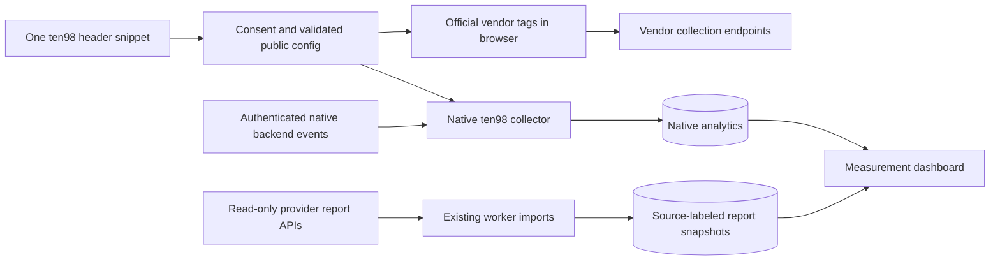

# Unified tracking and destinations

> Code and safety contracts retained from [docs/tracking.md at dcd1b3d](https://github.com/Ten98-IO-Company/ten98-monitor/blob/dcd1b3de5f7e0600c6b459e6b20f08b072106097/docs/tracking.md). Historical/planning checkpoints: [implementation archive](https://wiki.ten98.io/s/ten98-docs/p/unified-tracking-and-destinations-implementation-history-SFLN9C8i29). Qualifications are preserved; this adds no acceptance claim.

> **Conditional guardrails:** These proposal-derived excerpts preserve implementation, security and measurement constraints. They are not a catalogue of shipped APIs, adapters or services. Establish current support from the implementation and current operational runbooks.

## Product boundary and reuse

Owner decision after provider evaluation: use **native integrations**, not Zernio. The [setup and connection specification](https://wiki.ten98.io/s/ten98-docs/p/setup-critique-and-native-integration-flows-polbVhMXd2#nmivrtvkvxty) adds operator app registration, permission-aware account/property discovery, import preview, resumable authorization and actionable provider-approval states. This refines P71/P76/P78/P81 without changing the platform list. A reporting-only connector can require a broad upstream OAuth scope; disclose that and enforce allowed operations server-side.

The user outcome is: **install once, configure supported pixels centrally, and inspect your events alongside provider reports**. A site can use native analytics only, connect report imports only, or enable selected browser tags. Connecting a reporting account never activates a pixel. Adding a pixel never proves reporting access. There is no requirement to route third-party pixel requests through the ten98 server.

Reuse P27–P31 ingestion, P39 revenue, P57–P58 Google connections/reports, P66 durable jobs, P68 retention, and shared auth/credentials. Extend the existing tracker rather than installing a second ten98 tracker. Preserve the Umami-compatible script/event interface with an explicit mapping; historical data migration from the replaced apps is excluded by the owner.

GTM, [Cloudflare Zaraz](https://developers.cloudflare.com/zaraz/), and Segment-style destinations already solve parts of this problem. Zaraz provides events, triggers and actions, but retains a Cloudflare dependency even for [non-proxied sites](https://developers.cloudflare.com/zaraz/advanced/domains-not-proxied/). It cannot be the required Docker foundation. V1 provides an explicit externally-managed/coexistence state for GTM/Zaraz tags; automatic import of their entire configuration is not promised. Reuse audited adapter code only after exact file/dependency license review. No generic plugin marketplace, arbitrary JavaScript tags, transformation language, mandatory Redis/Kafka, or separate CDP service.

This module does not create campaigns, change bids/budgets, bulk-sync audiences or publish ads. Reporting is read-only; browser tags are separately enabled. A server-side advertising conversion gateway is not part of this addition: CAPI/Events APIs remain a possible separately scoped extension, while existing external CAPI integrations must be recorded during duplicate-ownership checks. Authenticated native analytics ingestion remains part of P28/P39 and is not an ad-platform proxy. External provider scripts, APIs and data remain governed by their terms and are not relicensed MIT by this application.

## Developer-declared HTML events

The native tracker accepts explicit click instrumentation through the same `track` → coordinator → native/destination policy gates as a JavaScript call:

```html
<button type="button" data-ten98-event="signup" data-ten98-event-plan="starter">Sign up</button>
```

One delegated capture listener handles the nearest declared element, including nested/dynamic descendants and browser-generated keyboard clicks. Event names follow the existing 1–64 character native contract; `page_view` is reserved for automatic page observations. Only `data-ten98-event-*` attributes on that element become properties. It reads no form values, page text, link destinations or other DOM content. Attributes supply primitive strings, with existing server-side ISO timestamp normalization unchanged; use `ten98.track` for typed numbers, booleans, arrays, nested objects or exact advertising conversion fields.

Reject the complete event for empty/over-80-character property keys, forbidden prototype keys, invalid Unicode/NUL, more than 50 properties, over-1,000-character values or more than 6,144 UTF-8 bytes of serialized properties. There is no truncation or implicit JSON coercion. All existing collection settings, exclusions, explicit refusal, DNT/GPC, configuration expiry and per-destination consent rules still apply; blocked clicks are discarded rather than replayed. Declared events fan out to the same configured sites as the existing JavaScript API. Repeated snippet initialization does not add another listener.

The workflow follows pinned Umami 3.4.0's declared-event pattern with an explicit namespace mapping: `data-umami-event` → `data-ten98-event`, and `data-umami-event-plan` → `data-ten98-event-plan`. Existing Umami attributes are not automatically consumed, avoiding two installed trackers claiming the same declaration. This does not implement general Umami script/API compatibility or complete P28.

Unlike Umami's awaited link handler, native tracking never prevents a click, delays navigation, submits a form or assigns a location. The existing bounded native event request uses Fetch `keepalive`; navigation delivery remains best effort, including first-request CORS preflight and the browser's shared 64 KiB in-flight keepalive-body limit. Individual bodies remain at most 16 KiB with the existing 20-request concurrency cap, five-second abort, privacy cancellation and bounded response reader. A lost receipt does not trigger a retry or beacon fallback. Identification and configuration requests do not use keepalive. See the [Fetch standard's keepalive quota](https://fetch.spec.whatwg.org/#http-network-or-cache-fetch) and [Request.keepalive](https://developer.mozilla.org/en-US/docs/Web/API/Request/keepalive).

## Provider capability matrix

All paths below are **planned**, not runtime-verified. Discovery records a separate status for tag configuration, SDK loading/invocation, reporting, account eligibility and test facilities. Every adapter records its supported contract/version and rechecks documentation before implementation/release. Some vendor scripts use unversioned URLs; disclose that limitation rather than claiming they are pinned.

| Connector | Browser integration | Reporting import | Mapping and access boundary |
|---|---|---|---|
| Meta / Facebook | Meta Pixel | Not planned (owner decision 2026-10-18) | Map standard/custom events and stable occurrence ID; if an external CAPI also sends an event, coordinate event ID/name or select one owner |
| Google Analytics 4 | Google tag | GA Data API; reuse P58 | Share the Google script loader with Ads but configure each destination once. Select one pageview owner; do not claim arbitrary `event_id` universally deduplicates events |
| Google Ads | Google tag conversion actions | Not planned (owner decision 2026-10-18) | Map conversion action and transaction ID explicitly; avoid duplicate primary actions or duplicate GA4-import/direct-tag conversions |
| Cloudflare | Official Web Analytics beacon, either ten98-managed or existing auto-injection; no custom-event destination | GraphQL Web Analytics/RUM and separately labeled edge datasets | No custom POSTs to `/cdn-cgi/rum`; no custom event or UTM support in Web Analytics. One beacon owner; report availability/sampling depends on dataset/access |
| TikTok | TikTok Pixel | Not planned (owner decision 2026-10-18) | Match event presets and occurrence ID; detect externally managed Events API ownership; reporting permission is separate |
| LinkedIn | Insight Tag | Not planned (owner decision 2026-10-18) | Map conversion rules/account and browser event IDs; approved reporting access and `r_ads_reporting` distinct from tag setup |
| Microsoft Ads | UET | Not planned (owner decision 2026-10-18) | Map UET tag/event names; reporting requires its own OAuth/developer/account access |
| Pinterest | Pinterest Tag | Not planned (owner decision 2026-10-18) | Browser occurrence `eventID`; app tier/scopes/account access required independently for imports |
| Snapchat | Snap Pixel | Not planned (owner decision 2026-10-18) | Browser `client_dedup_id` and purchase transaction IDs; coordinate with an external CAPI if already installed |
| X | X Pixel | Not planned (owner decision 2026-10-18) | `conversion_id` identifies the occurrence; X `event_id` identifies its configured event type. Conversion Only API access does not include analytics |

Use first-party event names `page_view`, `sign_up`, `generate_lead`, `view_item`, `add_to_cart`, `begin_checkout`, `purchase` and `refund`, plus validated custom names. Ship reviewed provider-specific mapping presets. Each preset declares supported SDK calls, required fields, consent purposes, eligibility, dedup keys/limits and test mode. Unsupported combinations remain explicit; a refund must not silently become a purchase, and Cloudflare cannot receive custom purchases. Freeze each platform's complete supported V1 event list during TRK-01; unlisted provider-specific features are not implied by a generic adapter name.

Any future Google Ads server conversion feature requires a separate scope and current Data Manager evaluation. See [provider evidence](#provider-evidence-and-unverified-details).

## Collection and event contract

One versioned snippet boots a bounded in-memory queue, loads public project configuration and accepts `page`, `track` and `consent` operations. It injects allowlisted official scripts after consent, initializes each unique provider/asset once, then issues supported calls directly in the browser. Native ten98 collection is an independent configured destination. A small framework-neutral API is sufficient; frameworks can call it after route transitions. Generated instructions cover HTML and SPAs, plus existing authenticated backend native events. A one-line installation does not infer purchases, revenue, login success or meaningful leads from arbitrary clicks. Developers instrument those events once; predefined HTML event attributes may reuse P28 without capturing form values.

Public configuration includes only site/environment IDs, consent purpose IDs, allowed destination IDs, mapping revisions, public pixel/measurement IDs and trusted script URLs. It excludes OAuth/API secrets, private reports and account administration data. Website keys are public identifiers, never authentication. Management publication requires role permission and CSRF protection; server business events use scoped, revocable credentials.

| Envelope field | Contract |
|---|---|
| `schema_version`, `event_id`, `name` | Validate size/type/version; one stable occurrence ID reused on retries and browser/server copies |
| `site_id`, `environment`, `occurred_at` | Server resolves workspace/project from trusted site configuration; UTC event time plus server receive time; separate test/live IDs |
| `source` | Browser observation vs authenticated backend event; trust assigned by server, never accepted from a client flag |
| `page`, `referrer`, campaign fields | Sanitized URL/path, allowlisted UTM/click IDs only under applicable permissions; strip fragments, credentials and unapproved query parameters |
| `properties` | Explicit typed allowlist and size limits per event; no automatic form/DOM text collection |
| `transaction_id`, `value`, `currency`, items | Purchase/refund schema; stable order identity, decimal-safe money and ISO currency; server-verified outcomes distinguish observed browser events |
| Consent receipt/version | Purpose-specific state and timestamp, site policy revision and revocation link; no fingerprint or inferred consent |
| Mapping/configuration version | Active immutable browser mapping; no historical event replay on republish or rollback |

Default to no cross-site identity matching. Optional authenticated user references are project-scoped and separate from workspace login. Enhanced matching/customer identifiers are disabled unless deliberately configured with appropriate consent and per-provider validation; never scrape email/phone from page fields. Hashing identifiers does not make them anonymous. Do not store matching fields in generic analytics properties, diagnostics or public exports. No server advertising dispatch store is needed for the direct browser architecture.

Native evidence uniqueness is `(site, environment, trusted_source_class, event_id)`: source class is assigned by the collector from authentication, not a submitted flag. Repeats within that evidence stream are idempotent; conflicting copies in that same stream are rejected/quarantined. Browser and authenticated backend evidence may differ and are reconciled separately. Canonical order revenue resolves from authenticated `(site, environment, order_id)` evidence regardless of arrival order; a browser observation cannot occupy that unique key, overwrite money or block the later authoritative record. Separate refunds need their own occurrence/refund ID linked to the order. Test browser-first, backend-first and forged browser-amount cases; do not force every action on an order to share one occurrence ID.

## Consent and trust boundaries

Offer an integration API for existing consent management platforms plus a small built-in preference UI for operators without one. The built-in UI covers our declared purposes, not a claim of universal legal/CMP certification. Enhanced analytics/advertising grants default to unknown/denied. Native cookieless basic collection is a separate current-policy mode described in the [measurement contract](analytics-measurement.md#collection-and-privacy); it grants no vendor permission. Honour explicit refusal, DNT and GPC; no browser-blocker or consent circumvention. Do not call pseudonymous native or advertising tracking anonymous or universally consent-exempt.

Consent is evaluated before consent-first native collection, before loading vendor scripts, and before each vendor invocation, including SDK-readiness queues. Cookieless basic collection instead requires its current policy and no explicit opt-out or browser privacy signal. Disallowed events are discarded rather than queued for later retroactive transmission. Store only necessary preference state before consent; do not buffer a visitor history while waiting. A new destination or expanded purpose cannot inherit an older narrower grant silently. Event-time and current consent must both permit a queued invocation. Withdrawal clears affected queues and stops future collection; it cannot retract already transmitted data. Purging provider-held data uses a separate supported deletion workflow or an explicit operator action. Historical reporting imports do not manufacture new visitor consent or outgoing tracking events.

These enforcement guarantees apply to ten98-controlled tags. External GTM/native integrations or Cloudflare auto-injection can run before our loader; require independently verified compatible consent gating, or instruct the operator to disable that owner before enabling ten98 management. Until verified, display external enforcement as unverified and block publishing that managed route. Never imply the loader can retroactively gate a script that already ran.

Map Google `analytics_storage`, `ad_storage`, `ad_user_data` and `ad_personalization` separately. Strict/basic blocking is the default; Google advanced-mode denied-state pings are not enabled implicitly. Vendor consent defaults must be set before configuration/events. Persist choices through the chosen consent solution. Test revocation with each loaded SDK; if it cannot stop ongoing automatic collection safely, require page reload and disable that deployment mode until verified. Removing a script element alone is not withdrawal enforcement.

Public ingress cannot prove a human purchase or defeat forged events using an Origin check. Apply body/rate/time limits, exact configured origins, abuse controls and workspace isolation; treat public events as untrusted observations. Require authenticated backend evidence for ten98 verified revenue. A browser pixel purchase is an observed browser event, not proof of an order. Do not turn incoming event properties into URLs, account IDs, scripts or provider credentials. Adapter endpoints and script origins are allowlisted. No arbitrary remote tag execution, custom HTML or unreviewed destination code.

## Browser loading and storage within the existing stack



Add a `tracking` module in the monolith, not another deployable service. Vendor events flow browser-to-vendor, not through the database/worker. Extend existing connections, analytics and jobs with:

- Destination configurations: workspace/project/site/environment, provider/account/pixel, capabilities, consent purposes, state, immutable revision and public/private field separation.
- Event mappings: canonical name, destination name/action, field allowlist, reviewed field mappings, tag owner and eligibility; no user-supplied executable transforms.
- Optional short-lived diagnostic records: invocation ID, destination/environment, config revision, script-load state, suppressed/unsupported/invoked/blocked status and redacted error. Diagnostic collection has its own limits and privacy rules; normal operation does not upload copies of vendor payloads to ten98.
- Reporting snapshots/sync cursors: provider/account/dataset, dimensions/date grain/timezone/currency, attribution settings, sampling/threshold flags, retrieval time and coverage. Connections may serve multiple authorized projects without importing the same account twice into a portfolio total.
- Domain records: canonical/serving/redirect role, normalized hostname, project owner, expected target, verification history, source property IDs and explicit aggregation group. Alias observations preserve the originally requested domain and separately resolved destination.

Initialize each vendor script and unique provider/asset once per page lifetime, independent of mapping revision. Shared script ownership is needed for GA4 and Ads. Apply only documented safe in-place updates; unsupported changes require a reload rather than another initialization/automatic pageview. Use small SDK-ready queues with TTL/capacity, cleared on withdrawal/config invalidation. A failing script cannot block the page, native collection or other vendors. Never blindly retry a conversion invocation after an ambiguous result: provider SDKs may already queue/transmit it. Preserve IDs and use only provider-documented deduplication, not an invented universal guarantee. No durable advertising delivery queue or server fallback in this scope.

Browser states are `not_configured`, `consent_blocked`, `loading`, `ready`, `invoked`, `unsupported`, `blocked_or_failed` and `unknown`. Invocation is not receipt or attribution. Cross-origin browser restrictions often prevent reading a vendor's response; debug UI must say so. Provider dashboards/test helpers and delayed report imports offer separate evidence, not guaranteed per-event acknowledgements.

Scheduled report imports use existing pg-boss leases, pagination, per-provider limits and bounded retries with Retry-After. Pause affected imports on revoked credentials/access; retain useful prior snapshots as stale. Upsert stable report keys only after validating response completeness; failed pages cannot zero an entire account. Keep import errors separate from browser-tag health. Republish, rollback, restore and account reassignment must not replay historic pixel events.

Public config uses a short bounded cache TTL, revision revalidation and an expiry. An expired/unavailable consent or destination configuration fails closed for new vendor initialization and ten98-triggered calls. Active pages revalidate on the documented interval; a kill switch has a measured propagation bound, not an instantaneous guarantee. Once loaded, third-party SDKs can have their own automatic listeners: use their verified disable/consent controls or require a reload. Do not claim ten98 can remotely unload arbitrary already-running JavaScript. Deployment guidance includes a restrictive CSP and only the enabled script/connection origins.

## Automatic consolidation without misleading totals

Three separate views share project/date/campaign filters: **our observed events**, **tag diagnostics**, and **platform reports**. Import native/provider aggregates into distinct tables; never feed reporting imports back to the collector or tag invocations. Use the same authorize/select-property/sync flow as GSC and GA4, adding datasets and least-privilege read access for the planned Cloudflare import. An operator may connect reports without installing a pixel, or configure a pixel without granting report access.

Ad-platform reporting imports are not planned (owner decision 2026-10-18): the browser tags above stay, but no Meta, Google Ads, TikTok, LinkedIn, Microsoft Ads, Pinterest, Snapchat or X report is imported. Search Console and GA4 retain their P57 and P58 reports. The one planned platform import is Cloudflare Web Analytics: available RUM/performance and separately labeled edge-request measures. AEO and GEO ad platforms such as OpenAI's ChatGPT ads are a research item only; first establish whether a public reporting API exists. Unsupported dimensions stay explicit. Connection setup previews available scopes, earliest retrievable date, selected history window, account timezone/currency, current limits and expected sync frequency. No scraping or shared vendor credentials to bypass unavailable API approval.

Request minimum available OAuth/token scopes, but enforce read-only behavior with a reviewed allowlist of account-discovery and report endpoints even when a provider offers only broad scopes. Validation and sync cannot call any mutation. Test that restriction. Login/property selection authorizes reads only.

The spend, conversion, ROAS and account-currency rules below apply only if an ad-platform reporting import is decided again; the Cloudflare import keeps the date-grain, timezone, sampling and freshness rules.

Normalize date grain, account IDs and units while retaining original values and definitions. Use explicit campaign IDs/UTM mappings with unmatched rows visible; never join campaigns only by display name. Attribute a ten98 conversion only from evidence collected under its stated model/window. Do not join aggregate provider reports into a person-level identity graph.

Spend/impressions/clicks may be combined only across distinct non-overlapping accounts, compatible definitions and currency/date boundaries. Deduplicate repeated imports and shared-account mappings. Do not sum reach/unique users, conversions attributed by different providers, or GA4 plus ten98 visitor totals. Show provider ROAS separately; an optional first-party ROAS uses one declared attribution model and reconciled order revenue. Zero denominators produce unavailable rates.

Preserve source currency; any converted view shows rate source/date and original amount. Fetch in each account's native timezone; daily aggregates cannot be re-bucketed exactly into another timezone without finer data. Display that limitation. Preserve view-through/click-through windows, modeled conversions, thresholding, sampling and delays. Re-fetch a bounded provider-specific lookback for late adjustments/refunds, replacing the same snapshot key rather than adding it again. Freshness, partial coverage, no data and revoked access remain distinct from zero.

## Canonical domains, serving domains and redirect aliases

Use one project with domain roles: **Canonical**, **Additional serving domain**, and **Redirect alias**. The owner's example is `crystal.re` as canonical with `crystal-group.ae`, `crystalgroup.ae` and `cre.sh` as redirect aliases. This is requested configuration intent; their live redirects/ownership have not been verified. Do not change DNS or redirect rules automatically.

Normalize domains consistently (IDNA, lowercase, ports and exact host boundaries); ownership/allowed collection origins and expected redirect targets are explicit. A wildcard for subdomains never grants ownership of another registered domain. Project admins can edit grouping, but must verify control before publishing pixels on a domain. Backlink research of a public domain does not require permission to alter it. Keep verification/check history and an effective date for group changes so historical reports do not silently change meaning.

An HTTP 301/302/307/308 normally redirects before any page JavaScript runs. Install the loader on pages that actually render; do not add a slow intermediate page solely to fire pixels. Redirect aliases can contribute evidence through existing server/CDN logs, an authenticated redirect-observation endpoint, or the existing P44 tracked-link/redirect facility when deliberately configured as the redirect owner. Cloudflare edge imports are optional; standard server log import works without Cloudflare. Browser tag middleware is not introduced by these native alias observations.

Store alias request observations separately: source record/unique request ID, original host/path, expected and observed destination, response status, timestamp and bot classification when supported. No request body, raw IP or arbitrary query string by default. Imports are authenticated, bounded and idempotent. Mark sources with no unique IDs as potentially duplicate rather than inventing exact counts. Cached redirects, bots, retries and abandoned navigations make redirect requests different from destination visits; never add both to total visitors.

Check expected paths, query preservation, loops, chain length, status code, HTTPS and final canonical URL with bounded public-target checks, using the existing audit/SSRF protections. Choose permanent versus temporary redirects deliberately. These checks diagnose actual behavior without editing infrastructure.

The final page cannot reliably recover the original alias from its referrer. Optional aggregate landing attribution can use a configured non-personal alias marker, such as `t98_alias=cre-sh`, set by a redirect rule. Validate it against the project registry, label it an unverified client hint (it can be forged), and never treat it as an identity. If the operator wants it hidden from vendors, consume/clean it from the address before initializing tags, with a tested application-router integration. Merely filtering manual event fields does not stop an SDK reading the page URL. Without such evidence or redirect logs, show alias attribution as unavailable. Do not overwrite original `utm_source` or make up a redirect trail. Preserve approved campaign/click parameters through redirects; remove sensitive URL data at its source or before tag initialization. No new cross-domain person ID or fingerprint is required.

Additional domains that genuinely serve pages may use optional vendor-native cross-domain linking after verified ownership, explicit allowlists and consent. It is a distinct setting from redirect aliases; a linker cannot execute on an HTTP-only redirect. Do not automatically share cookies/identities across `crystal.re` and unrelated registered domains.

For SEO, query canonical and alias targets separately, preserve the original backlink target and resolved destination, and expose redirect-chain/broken-link findings. DataForSEO can already include indirect links in the canonical result; combined unique backlink totals require deduplicated link-level coverage. If only overlapping summaries are available, show separate totals and mark a combined unique count unavailable. Never simply add canonical and alias summaries.

Connect separately verified GSC properties for different registered domains to one project; a `crystal.re` Domain property does not cover the other three. Preserve property scope and Google's canonical performance attribution. Avoid double-counting overlapping Domain/URL-prefix properties; sparse alias search data is not proof the redirect receives no requests. GA4/advertising reports retain account/property/hostname grain; where a report lacks domain granularity, show account-level scope rather than allocating it to aliases without evidence.

## Migration, operations and acceptance

Discover known existing snippets, GTM/Zaraz ownership, native platform integrations and Cloudflare auto-injection; discovery is advisory, not proof that no hidden tags exist. Require an explicit owner per provider/event/site/environment. Treat GA4 enhanced measurement and SPA auto-pageviews as possible duplicate sources. Choose one pageview owner; don't replay a historic consent-denied pageview after grant. Test navigation, back/forward and repeated initialization.

Use a draft/local dry-run first. Validate test modes against current provider behavior; if no safe test facility exists, require an explicit operator-controlled test account/event rather than fabricating a production purchase. Disable the old owner before enabling the new one for a route, then verify one occurrence and reconcile business totals. Never run uncoordinated dual browser tags. Rollback restores the previous configuration/owner without replaying old events. Live configuration tests are opt-in actions, never boot/healthcheck side effects.

Same web/worker/PostgreSQL Docker topology; no mandatory Cloudflare service. Add egress/CSP guidance only for enabled destinations, separate connection credentials per environment, and limits on script loading, SDK queues, diagnostics and imports. Restore starts report schedules paused; revalidate restored published configuration before allowing fresh vendor initialization, with a new revision epoch to invalidate stale state. Retention/erasure covers native events, consent references, snapshots, diagnostics and backups under the existing policy; source erasure does not claim automatic deletion at every third party.

Acceptance scenarios, all required before release:

1. Install once, create consented native pageview and explicit purchase, change pixels without a site redeploy; network evidence shows browser-to-vendor traffic without a ten98 conversion proxy. SPA navigation and repeated snippet initialization produce one intended call. Cloudflare beacon runs once.
2. Unknown/denied/withdrawn consent causes no disallowed collection, SDK load or invocation; grant is not retroactive. Queue delay, new purposes, multi-tab updates and config expiry cannot bypass the policy. Test actual vendor auto-collection shutdown/reload behavior.
3. Reloads, repeated initialization, mapping revision on an active page and existing external browser/server integrations preserve occurrence identity and one owner without another automatic pageview. Backend-first/browser-first/forged-browser-amount cases preserve authoritative order revenue; X event-type IDs are not occurrence IDs.
4. Each named browser adapter passes allowed/unsupported mappings, currency/ID validation, test/live separation, blocked script and a controlled configured-provider check. Reporting separately proves correct account access, expired auth and missing approval states. Stubs alone do not verify a provider.
5. Blocked SDKs, cross-origin response restrictions and ambiguous invocations never trigger blind conversion retries. Reporting 429, pagination, partial failure, revoked credentials and worker crash recover without duplicate snapshots. Other providers and native collection remain usable.
6. Two workspaces/environments cannot read keys, publish each other's configuration, import another account or inspect diagnostics. Public spoofing cannot create verified native backend revenue or select arbitrary script/connection endpoints.
7. Repeated imports, multi-project account mapping, late adjustments, mixed currencies/timezones and unattributed traffic reconcile without fabricated totals; snapshots never generate outgoing conversions.
8. Legacy GTM/Zaraz, native integrations and Cloudflare auto-injection migrate and roll back with one owner; no automatic deletion of existing configurations. Shared Google loader initializes GA4/Ads correctly without duplicate pageviews or goals.
9. Measure script bytes, browser requests, page performance, native collector latency and import storage with zero, one and all ten connector entries enabled. Bound SDK queues and import concurrency; report visible failure rather than unlimited buffering or a zero-overhead claim.
10. Canonical/serving/redirect roles, all four example domains, exact-host authorization and separately scoped GSC properties work. A redirect-only response records no fictitious pixel execution. Logs/landing hints and destination visits stay distinct; cached redirects/unknown origins remain coverage limitations.
11. Alias chains, query preservation, loops, safe target checks, deduplicated log imports and overlapping indirect backlinks yield correct separate/grouped results. Summary-only backlink counts cannot produce an invented unique combined total; no redirects or DNS change automatically.
12. Publish/rollback/kill switch propagation, offline/expired config, backup restore with imports paused and configuration revalidation, consent erasure and accessibility flows pass independent GPT review.

## Provider evidence and unverified details

Primary sources checked 2026-10-12; no live provider integration was exercised. Links are research references, not instructions or proof of runtime support. Do not copy documentation wholesale into application code.

- Meta: official SDK [server-event contract](https://github.com/facebook/facebook-nodejs-business-sdk/blob/main/src/objects/serverside/server-event.js). Canonical Meta docs were rate-limited during review; exact current dedup window, app review and permissions must be verified in TRK-01.
- GA4: [Measurement Protocol limitations](https://developers.google.com/analytics/devguides/collection/protocol/ga4), [Data Manager comparison](https://developers.google.com/data-manager/api/devguides/events/analytics/measurement-protocol/upgrade), [recommended/custom events](https://developers.google.com/data-manager/api/devguides/events/analytics/recommended-custom-events/send-events), [Data API](https://developers.google.com/analytics/devguides/reporting/data/v1), [Google consent setup](https://developers.google.com/tag-platform/security/guides/consent). Transaction-based dedup is endpoint/event-specific; do not generalize to all GA4 events.
- Google Ads: [transaction IDs](https://support.google.com/google-ads/answer/6386790), [current API changes](https://developers.google.com/google-ads/api/docs/deprecations), [Data Manager offline events](https://developers.google.com/data-manager/api/devguides/events/google-ads/offline).
- Cloudflare: [Web Analytics FAQ](https://developers.cloudflare.com/web-analytics/faq/) and [GraphQL Analytics](https://developers.cloudflare.com/analytics/graphql-api/). RUM and edge requests have different populations; preserve sampling metadata and entitled dataset limits.
- TikTok: [deduplication](https://ads.tiktok.com/resources/help/article/event-deduplication?lang=en), [business reporting reference](https://business-api.tiktok.com/portal/docs/api-reference/v2.0). Verify timing and reporting scopes against the selected API version.
- LinkedIn: [deduplication](https://learn.microsoft.com/en-us/linkedin/marketing/conversions/deduplication), [access/permissions](https://learn.microsoft.com/en-us/linkedin/marketing/increasing-access). No fixed dedup window was verified; do not invent one.
- Microsoft: [UET Conversions API](https://learn.microsoft.com/en-us/advertising/guides/uet-conversion-api-integration), [API access](https://learn.microsoft.com/en-us/advertising/guides/get-started). Event-age limits are not dedup-window guarantees.
- Pinterest: [Conversions API](https://dev.pinterest.com/docs/track-conversions/track-conversions-in-the-api/), [OAuth](https://developers.pinterest.com/docs/getting-started/set-up-authentication-and-authorization/), [access tiers](https://developers.pinterest.com/docs/key-concepts/access-tiers/).
- Snapchat: [deduplication](https://www.developers.snap.com/marketing-api/Conversions-API/Deduplication), [authentication](https://developers.snap.com/marketing-api/Ads-API/authentication). Purchase/order and general event dedup paths have different windows.
- X: [web conversions](https://docs.x.com/x-ads-api/measurement/web-conversions), [Ads API access](https://docs.x.com/x-ads-api/getting-started/step-by-step-guide). No numeric dedup window was verified; conversion-only access must not be presented as reporting access.
- Domains: [HTTP redirects](https://developer.mozilla.org/en-US/docs/Web/HTTP/Guides/Redirections), [Google redirect guidance](https://developers.google.com/search/docs/crawling-indexing/301-redirects), [Cloudflare query preservation](https://developers.cloudflare.com/rules/url-forwarding/single-redirects/settings/), [Google cross-domain linking](https://developers.google.com/tag-platform/devguides/cross-domain), [GSC property boundaries](https://support.google.com/webmasters/answer/34592), [canonical reporting](https://support.google.com/webmasters/answer/17011259), [DataForSEO indirect backlinks](https://docs.dataforseo.com/v3/backlinks-summary-live/). Alias request counts and backlink summaries cannot be blindly added to canonical metrics.
