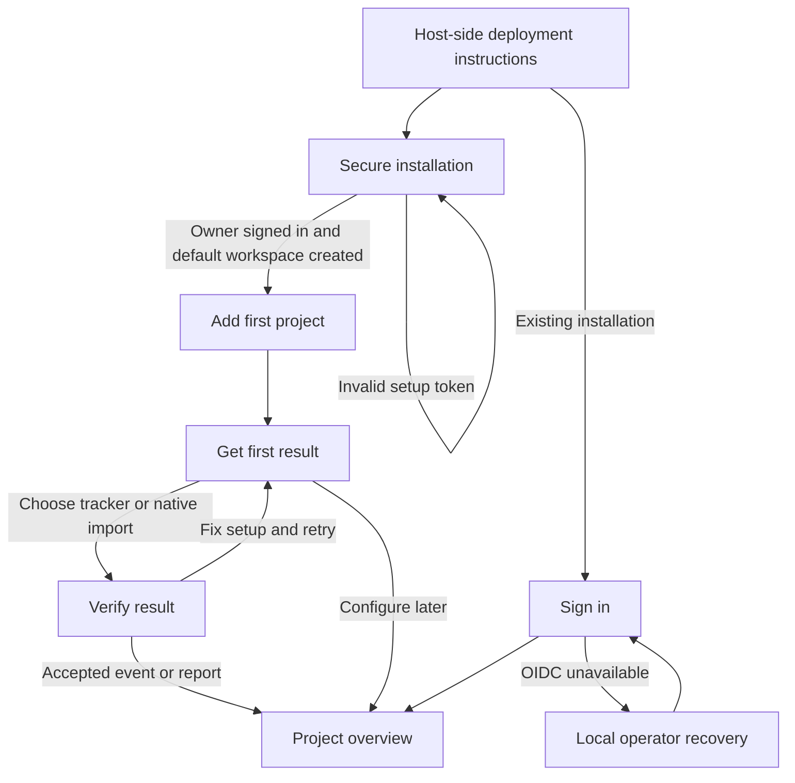
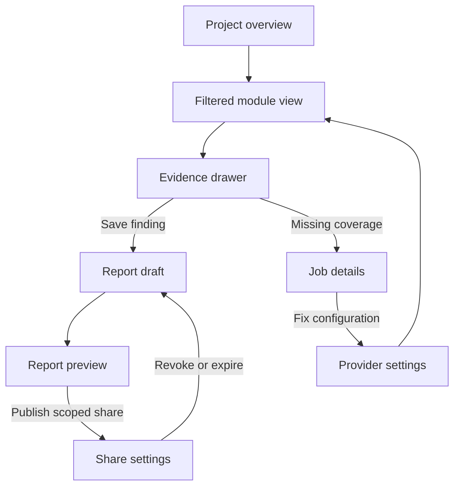
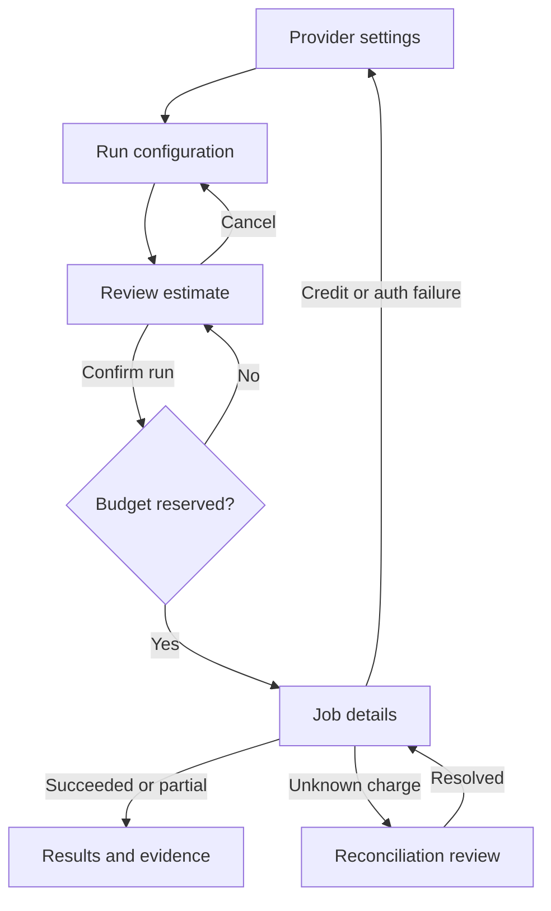

# UI and user flows

Status: GPT-authored design plan and low-fidelity wireframes. Example figures below are fictional; they are not live measurements.

## Audience and organizing idea

An operator installs and maintains the system; an agency owner manages client workspaces; an analyst answers what changed across visits, search and AI answers. The product's main job is to connect a finding to its evidence and an authorized next action.

Use one workspace switcher, one project selector, one date/market bar and a consistent evidence drawer. Avoid three homepages and three competing versions of the same project settings. The signature interaction is an evidence trail: every important number opens the observations, query and provider coverage behind it.

## Navigation and visual system

```text
Workspace switcher / Project selector
  Overview
  Analytics   Overview · Realtime · Events · Sessions · Reports · Replay · Heatmaps
              Funnels · Goals · Journeys · Retention · Cohorts · Revenue · Performance
              Boards · Links · Pixels
  Search      Keywords · Domains · Competitors · Rankings · Backlinks · Site audits
              Search Console · Google Analytics · Local SEO
  AI visibility  Overview · Prompts · Responses · Citations · Share of voice
                 Query fan-out · Opportunities · Research
  Tracking    Destinations · Event mappings · Preview · Tag diagnostics · Imported reports
  Domains     Canonical · Serving domains · Redirect aliases · Verification
  Reports     Library · Templates · Shares
  Assistant   Project conversations and approved actions
  Operations  Jobs · Alerts · Usage
  Connections Native accounts · Selected assets · Import coverage · Reconnect
  Settings    Project · Team · Providers · Recording · API/MCP
Instance settings: Identity · Integration apps · Storage · Email · Backups · Health (operators only)
```

Keep the primary sidebar short; reveal module subnavigation on entry. Persist workspace/project/time selections in shareable URLs but never credentials. Mobile navigation is a drawer; dense tables scroll within their region, and key decisions stay readable at 360px.

| Token | Proposal |
|---|---|
| Canvas / surface | `#F3F6FA` / `#FFFFFF`, cool neutral work surface |
| Text / secondary | `#17243A` / `#475569` |
| Action / focus | `#1746A2`, restrained blue links, primary action and focus ring |
| Positive / caution / failure | `#166534` / `#854D0E` / `#B42318`, always accompanied by labels/icons |
| Typography | System sans for navigation/body; tabular numerals and system monospace for IDs/evidence; no remote font dependency |
| Layout | 240px sidebar, 64px top bar, 8px spacing rhythm, compact 6px control radius; evidence drawer 420px on wide screens |
| Charts | Consistent domain colors and labeled series; table equivalent; missing data creates a gap rather than a zero |

Default light theme, dark/high-contrast variants after token validation within V1 UI acceptance. Preserve the source baseline locale inventory, language selector, localized number/date formatting and RTL layout; M0 maps every locale and translation gap. Use semantic HTML, visible focus, keyboard-operable tables/dialogs, skip link, 44px primary touch targets, reduced motion and accessible validation. Test text contrast at least 4.5:1, UI indicators 3:1, zoom/reflow, and screen-reader names. These are design targets, not a completed accessibility audit.

## Flow 1 — install to first trustworthy event

User: operator/analyst with a domain. Success: an authenticated project shows one accepted test visit with diagnostic evidence, or a selected source report with coverage. The [setup critique and complete wireframes](onboarding.md) supersede the original separate claim/sign-in/workspace wizard. Paid provider setup, email and OIDC are optional in this first-result path; their V1 capabilities remain required.



| Screen | Intent | Primary action | Recovery |
|---|---|---|---|
| Secure installation | Establish owner and default workspace safely | Create owner | Expired token regenerated locally; existing state never reopens owner claim |
| Sign in | Authenticate returning local/OIDC identity | Sign in | Recovery/2FA backup code; never bypass authorization |
| Add first project | Record domain, name and timezone | Create project | Manual brand setup works without providers; workspace rename is optional |
| Get first result | Choose visits, existing reports, search or audit | Continue | Configure later; provider prerequisites affect only selected outcome |
| Verify result | Prove tracker acceptance or selected-source read/import | Verify setup | CSP/origin checks or authorization/account/worker diagnostics; retain draft |
| Project overview | Read collected evidence | Inspect finding | Show “No visits yet” with install link, not synthetic data |

```text
Secure installation                Add first project
+--------------------------------+ +--------------------------------------+
| Set up ten98-monitor            | | Add a project                        |
| Setup token     [••••••••]      | | Name [Example Store]                 |
| Owner email     [             ] | | Website [https://example.com]        |
| Password       [             ] | | Timezone [Asia/Dubai]                |
| [Create owner]                 | | [Create project]   Cancel            |
+--------------------------------+ +--------------------------------------+

Get first result / Verify result
+-----------------------------------------------------------------------+
| Example Store / Choose website visits or import existing reports      |
| For website visits: add this script. [Copy snippet]                    |
| Last event: none · Recording: off · Optional providers: not configured |
| [Verify setup]    Configure later                                    |
| Diagnostics: script fetched / request blocked / event accepted        |
+-----------------------------------------------------------------------+
```

## Flow 2 — finding to evidence to action

User: analyst. Success: explain a change with comparable data and save an actionable report without conflating sources.



```text
Project overview
+------------------------------------------------------------------------+
| Workspace: Example agency / Project: Example Store  [Last 30 days]      |
| Overview     Data updated 10:45 · 2 jobs paused [View jobs]              |
| Finding                      Evidence                       Next step  |
| Search visits fell           GSC vs visits; 3 missing days   [Inspect]  |
| AI citations increased       84/90 successful samples        [Inspect]  |
| Product pages are slow       LCP p75, sample count 240        [Inspect]  |
| Visits [chart]    Search [chart]    AI answers [chart]                    |
| Independent measures; common date range and evidence links             |
+------------------------------------------------------------------------+

Filtered module view                            Evidence drawer
+---------------------------------------------+ +------------------------+
| AI visibility · market US/en · surface API   | | Observation            |
| Coverage: 84 success / 90 scheduled          | | Prompt / UTC time      |
| Brand mentions: 28/84 · formula version 1    | | Provider / actual model|
| Date | Prompt | Engine | Mention | Cost     | | Answer and citations   |
| ...  | ...    | ...    | ...     | ...      | | Match explanation      |
| [Open selected evidence]   Export           | | [Save finding]         |
+---------------------------------------------+ +------------------------+
```

Detailed module views follow the same filter/table/chart/drawer pattern. Analytics adds event/session detail, funnel step definitions and replay controls; Search adds keyword/SERP/backlink/crawl-issue detail; AI adds prompt/model/surface/sample coverage. Drilldowns retain the active comparison/timezone. Replay is separately permissioned and clearly marked as recording, not a chart.

## Flow 3 — configure providers and run paid work

User: admin/editor with spend permission. Success: a quoted bounded run settles once and displays partial outcomes honestly.



```text
Provider settings
+------------------------------------------------------------------------+
| Data and models                                                        |
| DataForSEO [Connected] [Edit credential]  Balance checked 4 minutes ago |
| OpenRouter [Connected]  Routing [Direct / Cloudflare AI Gateway]        |
| Browser [Local worker / Cloudflare Browser Run]                         |
| Workspace budget [      ] Currency USD · Reset [Monthly]                |
| [Save provider settings]  Connection tests show any cost before running |
+------------------------------------------------------------------------+

Review estimate                            Job details
+----------------------------------------+ +--------------------------------+
| Run 12 prompts × 3 engines × 2 samples | | Run #104 · 51/72 completed     |
| Market US/en · consumer/API labeled    | | 49 success · 2 failure        |
| Estimate [quoted range + time]         | | Reserved / settled / uncertain|
| Maximum authorized charge [value]     | | [View results]                |
| [Confirm run]  Back                    | | Pause future work · Cancel    |
+----------------------------------------+ +--------------------------------+
```

Browser, gateway and email choice forms reveal only relevant fields. Never display secret values after saving. Changing provider/mode preserves the existing configuration until validation succeeds. “Cancel” stops undispatched work; the UI explains any already-dispatched billable work.

## Flow 4 — audits, reports, alerts and assistant

| Entry | Minimal happy path | Primary actions | Failure/return path |
|---|---|---|---|
| Site audits | Audit setup → Review estimate → Job details → Audit results → Issue detail | Start audit; Inspect issue | Invalid/private target returns to setup; page errors remain visible; rerun only selected failures |
| Reports | Report draft → Report preview → Share settings | Save report; Publish share | Preview unsafe HTML safely; permissions/cost failure returns to draft; revoke from settings |
| Alerts | Alert rules → Test delivery → Delivery history | Save rule; Send test | Invalid sender or recipient shows field error; partial recipients retained; no blind resend after timeout |
| Assistant | Conversation → Proposed tool action → Confirm scope/cost → Evidence-backed result | Send request; Confirm action | Denied/over-budget tool returns editable proposal; rendered page instructions never authorize actions |
| Workspace access | Members → Invite/select role/projects → Pending invitation → Member active | Invite member | Email failure retains pending record; resend bounded; removed user loses session/token access |

```text
Audit setup                              Alert rules
+--------------------------------------+ +--------------------------------+
| Website [https://example.com]        | | When [Rank drops by threshold] |
| Mode [HTML / Render JavaScript]     | | Project/keyword [          ]   |
| Browser [Local / Cloudflare]        | | Debounce/cooldown [         ]   |
| Limits: pages, time, depth, bytes   | | To [verified recipients]      |
| [Review estimate]                  | | Delivery [SMTP / Cloudflare]  |
+--------------------------------------+ | [Save rule]  Send test         |
                                         +--------------------------------+
Report preview                           Assistant
+--------------------------------------+ +--------------------------------+
| Search and AI report · Draft        | | Project context · Conversation |
| Sources, interval, coverage         | | User question / sourced answer |
| [Publish share]    Edit             | | Proposed action: run 10 checks |
| Share: selected report only         | | Scope / estimate / permissions |
| Expiry [date]  No workspace access | | [Confirm action]   Cancel      |
+--------------------------------------+ +--------------------------------+
```

## Flow 5 — centrally managed pixels, imports and domains

The [tracking flow and wireframes](tracking.md#ui-flow-and-wireframes) add: Tracking overview → Connect destination → Map events → Test delivery → Review and publish → Measurement dashboard. Browser tags send directly to vendors. Import permissions are a separate connection path; imported reports remain source-labeled.

The [domain flow](tracking.md#canonical-domains-serving-domains-and-redirect-aliases) adds canonical, serving and redirect roles, verification and redirect checks. Redirect aliases show server/edge observation setup instead of a misleading pixel-install instruction. Alias requests, landing visits and backlinks are distinct evidence.

Both flows reuse the shared project scope, date filters, evidence drawer, accessible forms, drafts and loading/error states. No ad-management or DNS-editing controls are introduced.

## Flow 6 — native connections and identity setup

The [native connection journey](onboarding.md#flow-b-native-accounts-and-imports) is Choose connection → operator readiness if needed → Authorize account → Select assets → Review import → Import status → Source report. Integration app registration is instance-scoped; accounts/tokens/imports remain workspace-scoped. Connecting reports and publishing pixels are independent actions. Broad upstream grants such as Google Ads OAuth must not be mislabeled read-only; ten98 enforces reporting-only operations.

The [OIDC journey](onboarding.md#flow-c-oidc-without-locking-out-the-operator) is Add identity provider → Register client → Test sign-in → Review access → Enable provider, with local operator recovery retained. Draft testing does not replace working configuration, link accounts or commit memberships. Explicit identity linking requires proof of both identities. Returning users resume saved setup rather than repeat owner/project creation.

## Screen states and accessibility contract

| Screen family | Empty | Loading | Error | Success |
|---|---|---|---|---|
| Setup/login | Explain required fields | Disable duplicate submission, retain fields | Inline errors; focus error summary | Announce destination; no surprise paid jobs |
| Overview/module tables | Useful next action; unknown ≠ zero | Skeleton with stable layout; state last refresh | Keep old data with stale label | Timestamp, count and comparable period visible |
| Evidence/replay | “No evidence returned” plus reason | Cancelable fetch; no autoplay recording | Retry authorized fetch; no raw stack/secrets | Provenance and accessible text/table alternatives |
| Providers/run estimate | Missing integration affects only its functions | Free or approved test visibly running | Explain auth/credit/limits independently | Timestamp and capability list; secret stays masked |
| Jobs/audits | No run yet, configure action | Real durable progress, partial rows | Paused/failed/uncertain distinct; safe recovery action | Counts, cost settlement and evidence links |
| Reports/shares | Create from template/finding | Preserve draft | Failed save/sharing retains unsent edits | Scope, expiry and revoke shown |
| Alerts/email | No rule, add rule | Test with explicit recipients | Per-recipient result; uncertain delivery shown | Test event and delivery timestamp recorded |
| Assistant | Example prompts grounded in project | Cancel generation/tool proposal | No action implied after denied/failed tool | Sources and actual action results separated |

Keyboard/screen-reader checks cover workspace selection, a filterable table, cost confirmation, local/OIDC sign-in, 2FA, replay controls, a report share and the assistant action dialog. Every dialog restores focus and has a labeled cancel path. A table/chart cannot communicate success/failure by color alone.

## Design critique and open decisions

The initial three-product dashboard idea overemphasized headline numbers and concealed missing samples. The revised design prioritizes findings and evidence coverage, with module detail one click away. The shared settings shell removes duplicate provider/budget forms. The most consequential action is always specific: “Confirm run,” “Publish share” or “Send test,” with its scope visible.

Risk: full navigation can overwhelm an analyst. Use module-local navigation and permissions to reduce visible choices without deleting capabilities. Risk: automatic cross-module recommendations imply causation. Show linked evidence and explicitly separate observed measures. Validate onboarding with a first-time operator and evidence investigation with an analyst before implementing all screens.

Open: additional languages beyond the source baseline, user-tested density preferences, exact alert thresholds and optional per-client branding depth. Sharing uses revocable slugs under the installation's configured domain; no separate per-client domain setup is required. No subscription-sales UI is planned; the owner requires free full-feature access.
